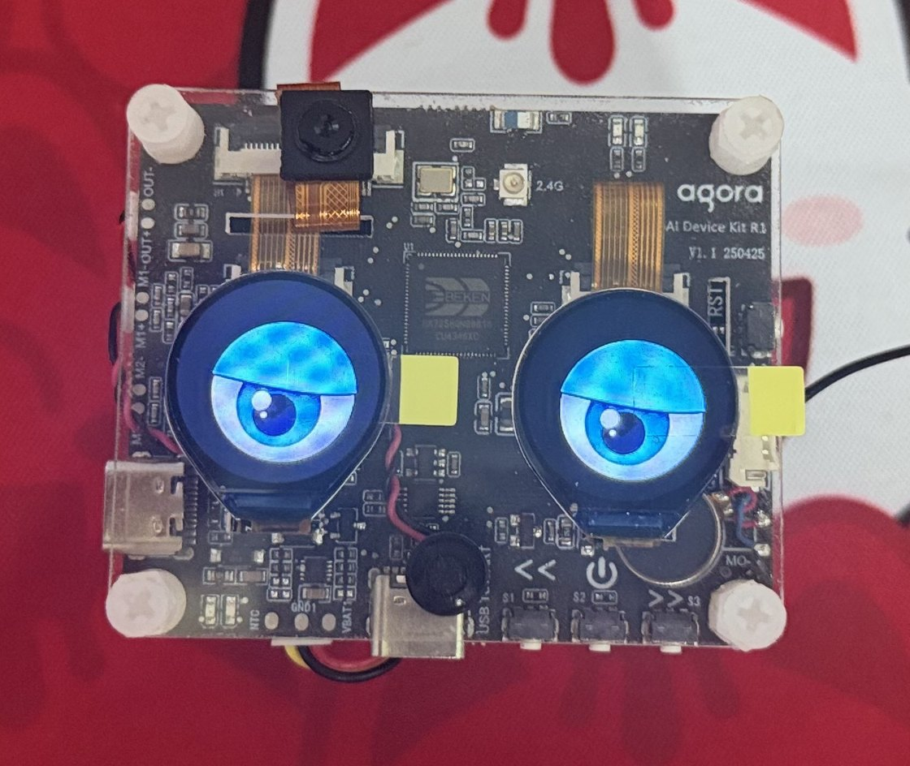
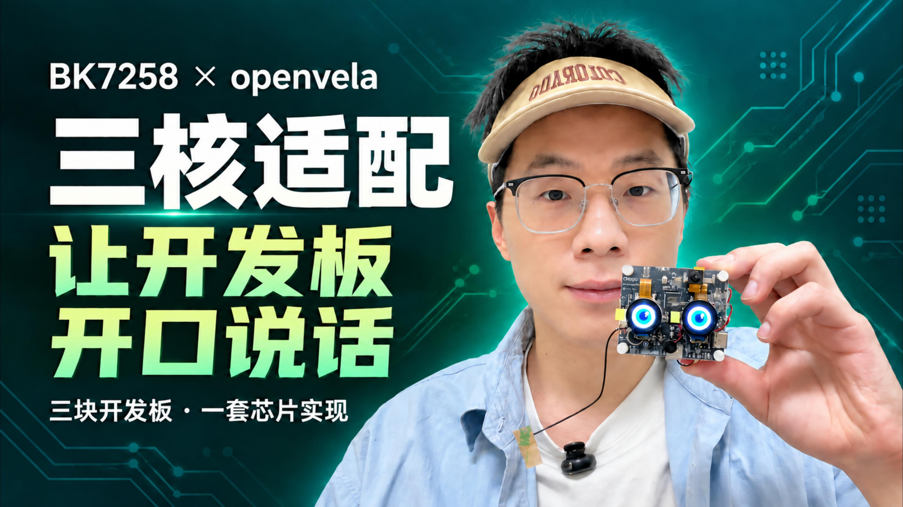
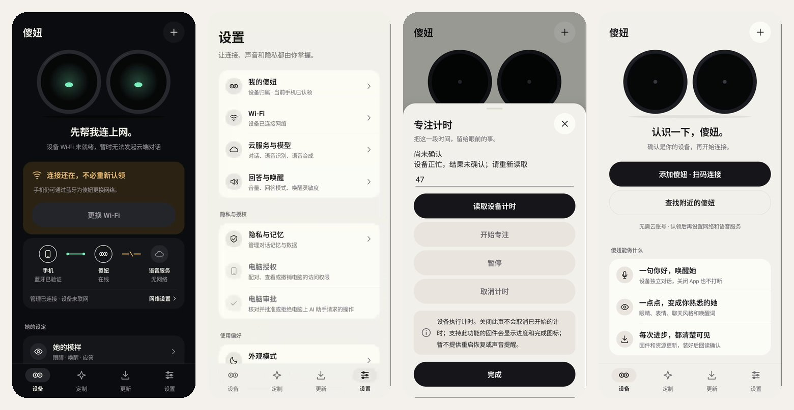
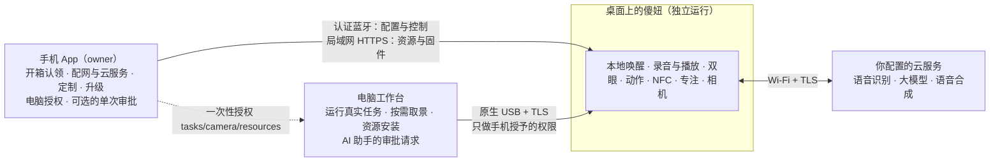
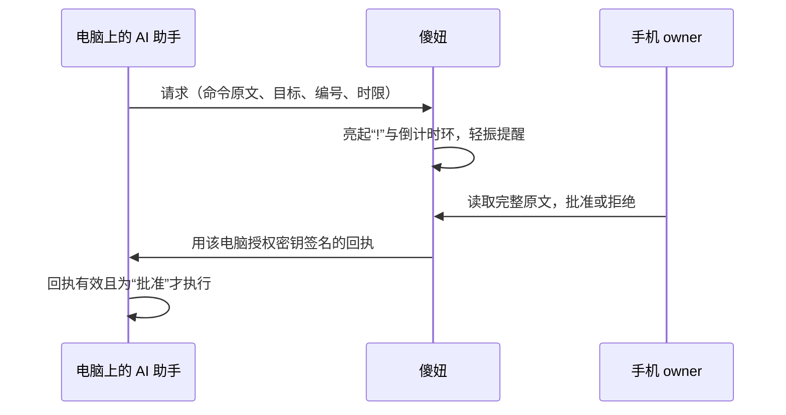
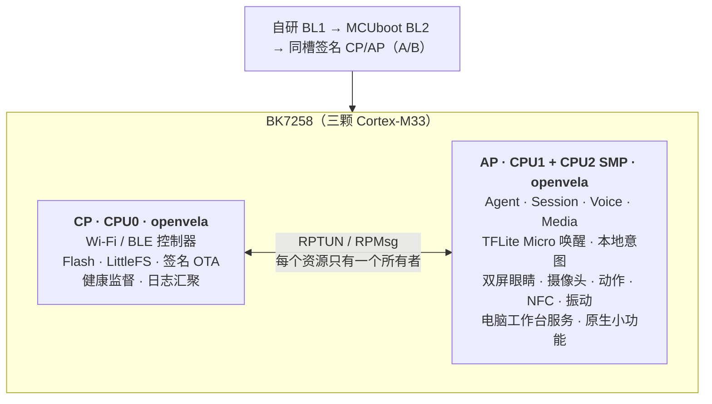
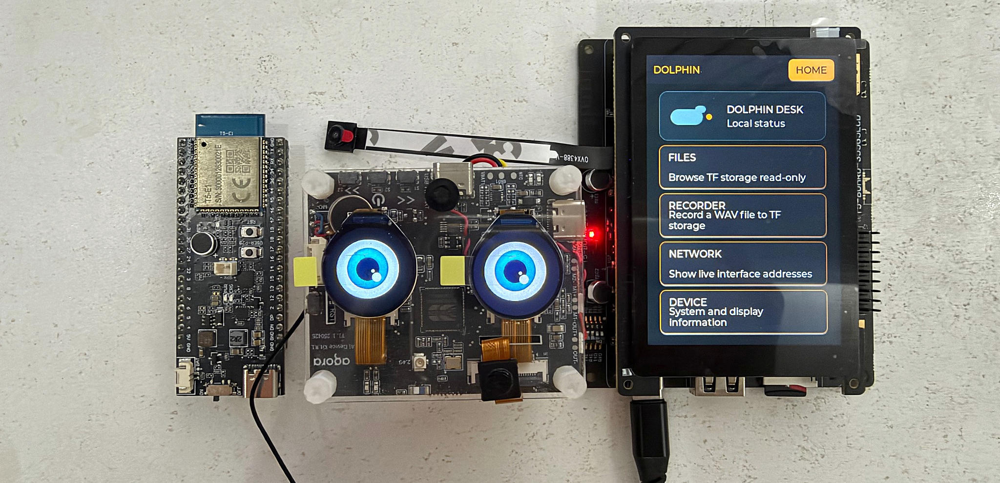

# 傻妞：放在桌上的 openvela AI 伴侣

[English](README_EN.md) · [功能与证据清单](docs/platforms/bk7258/shaniu-feature-inventory.md) · [上手与演示教程](docs/platforms/bk7258/shaniu-user-guide.md) · [板级当前验收](boards/bk7258/CONFIGS.md) · [Android App](android/shaniu-companion/README.md) · [构建 CLI](tools/bk7258/README.md) · [技术报告（9 月 20 日快照）](docs/contest/技术报告-BK7258三核适配与傻妞AI伴侣.md)

<p align="center">
  
</p>

傻妞是一台放在桌上的 AI 伴侣。对她说“你好，openvela”，她会自己联网听懂、
回答，并用两块圆屏眼睛表现她正在听、在想还是在说。她能拍下你举到镜头前的东西，
能被拿起来时做出反应，能替你计时专注，也能接收电脑上长任务的结果，到点时轻轻
振动提醒。手机只在开箱认领、填写网络和云服务、定制与升级时出场；电脑经手机
授权一次后，才能把任务结果交给她，或为它的 AI 助手请求一次手机批准。

她运行在一颗 **BK7258** 三核芯片上：CPU0 运行负责无线、存储和升级的
openvela CP 实例，CPU1/CPU2 以 SMP 方式运行负责语音、显示和 Agent 的 AP 实例。
同一套芯片适配还复用到另外两块板，其中 T5-Board 运行图形工具 Dolphin。

参赛方向：**新硬件平台适配 + AI 硬件产品创新**，与[技术报告](docs/contest/技术报告-BK7258三核适配与傻妞AI伴侣.md)中的作品范围一致。

> **复现与验收边界。** 先用 `git rev-parse HEAD` 核对下载的源码提交，再在官方
> [Actions 工作流](https://github.com/open-vela/contest2026_135_yongwangzhiqian/actions/workflows/shaniu-source-checks.yml)
> 中核对同一提交的构建与独立交付校验。它们证明固定 manifest 能在干净环境构建开发身份
> 签名固件与 App，不等同于作者签名发布或整机验收。逐项能力的证据层级见下表和
> [功能与证据清单](docs/platforms/bk7258/shaniu-feature-inventory.md)；板级结论只在
> [CONFIGS.md](boards/bk7258/CONFIGS.md) 维护。

11 月 4 日三轮源码评审的 11 项缺陷及历史导出、资源发布中断两项补充问题已修复，
回归、App 59 与 778 固件编译和签名包校验通过。实机设备发现、重新认领、蓝牙认证及状态回读通过；
用户随后确认对话、拍照成功，并确认本轮验收通过。
详见[修复、产物哈希与验收边界](docs/verification/bk7258/2026-11-04-finals-review-repairs.md)。

官方模板要求 README 说明作品、方向、目录、运行方式与 AI Coding 使用；规则见[大赛总览](https://github.com/open-vela/docs/blob/dev-ai-contest-2026/zh-cn/contest_2026/contest_overview.md)、[代码提交指南](https://github.com/open-vela/docs/blob/dev-ai-contest-2026/zh-cn/contest_2026/code_submission_guide.md)和[AI 日志手册](https://github.com/open-vela/docs/blob/dev-ai-contest-2026/zh-cn/contest_2026/ai_coding_log_guide.md)。本项目以 Claude Code/Codex 协助需求拆解、实现、诊断与文档；日志入口为 [`logs/README.md`](logs/README.md)。历史导出保留 collector 标签 `lijian`，本轮脱敏增量在 `logs/Embracecactus/`；两者不因当前 GitHub 用户名不同而改写身份字段。内部推理、上下文、媒体及敏感载荷不公开或脱敏/哈希，归集工具不会自动 push。211 份会话、113,146 条事件通过官方格式校验，公开快照的完整性限制见日志入口。

## 她现在能做什么

证据层级从低到高：**实现** → **主机/模拟器测试** → **实板观察** → **真机手机** →
**人工确认**。每条只写到已有记录的最高层级和对应版本，旧版本的实板结果不等于
当前源码已通过。

| 能力 | 你怎么用 | 依赖 | 最高证据（日期 · 版本） |
| --- | --- | --- | --- |
| 本地唤醒、连续问答 | 说“你好，openvela”，听到回应后提问；回答播完可直接追问 | 唤醒在设备上；识别、回答、合成需要 Wi-Fi 和云服务 | 实板完整链路：09-20 · `18.6.401+638`。11-03 真人唤醒在本地两次命中，但设备缺少网络与云配置，对话按设计未启动（`ENETDOWN`） |
| 本地固定指令 | “音量调到 50”“换成开心表情”“停止说话”“开始专注 25 分钟” | 仍需云端把语音转成文字；命中后不再请求大模型。播报期间 MIC 已释放，因此不是声学打断 | 主机测试与 AIDK 构建；新指令尚未实板验收 |
| 拍照识物 | “看看这个，这是什么？” | 云端多模态模型 | 实板：09-20 · 639 用户确认；颜色识别有错例，无准确率统计 |
| 双眼表情与状态 | 聆听、思考、说话、离线等状态自动显示；可换表情资源包 | 本地 | 实板：641 两套资源跨复位保持；11-03 表情切换渲染与回读一致 |
| 拿起、倾斜时的表情；完成时振动 | 拿起或倾斜设备；专注或电脑任务完成时轻振 | 本地加速度计与振动马达 | 实板：11-03 采样更新、两次振动驱动返回 0；拿起动作与振感尚待人工确认 |
| 专注计时 | 语音、App、NFC 卡或电脑开始/暂停/继续/取消 | 本地计时器 | 模拟器与主机测试；语音入口未实板验收 |
| NFC 场景卡 | 用 App 把卡登记为“开始专注”“播放本地内容”“启动小功能”等，之后碰卡即可 | MFRC522 读卡；ISO14443A UID 卡 | 模拟器登记草稿；实板无卡扫描返回 `-110`，尚无实卡触发记录 |
| 事实记忆 | 开启记忆后说“记住我叫……”；在 App 中查看、纠正、删除 | 设备加密保存 | 真机手机 + 实板：11-01 新增、纠正、删除与重启回读 |
| Runtime Skill | “专注助手：……”“设备体检：……”“识物解说：……” | 云端 Agent；外部 Skill 需签名 | 真机手机 + 实板：11-01 启停重启保持 |
| 电脑任务反馈 | 电脑用 `workbench task-run` 运行真实命令，结果交给傻妞 | 原生 USB；手机授予的 `tasks` 权限 | 实板：11-03 正常结束与超时取消回执均确认；屏幕与振感未人工确认 |
| 电脑按需取景 | 浏览器工作台点“采一帧”、保存、取消后重拍 | 原生 USB；`camera` 权限 | 实板：11-03 两帧 640×480，[55 秒原速录屏](docs/verification/bk7258/2026-11-03-feature-validation/videos/board/camera-capture-cancel-recapture.mp4) |
| 手机单次审批 | 电脑上的 AI 助手请求某条命令，等待批准时傻妞亮“!”，手机 owner 批准或拒绝 | 已认领的手机；电脑已有 `tasks` 权限 | 11-04 `0.7.129+775`：一次请求等待批准时双眼感叹号、批准后清除，`approved`、`authenticated=true`、返回 0；拒绝/超时/多轮未在 775 回归 |
| 认领、配网、设置 | App 扫设备屏幕上的认领码，经认证蓝牙填写 Wi-Fi 与云服务 | 手机；认领本身不需要互联网 | 真机手机：637/641 认领、10-18 与 11-01 Mi 10 联调；11-04 只读 Mi 10：实际安装 `0.7.28-shaniu-mimo-chat` / code 58 的云配置保存并回读、设备报告 Wi-Fi 就绪；这不是语音、BLE 生命周期或 OTA 验收 |
| 资源与唤醒模型更新 | App 安装眼睛资源包（Wi-Fi）、切换或导入唤醒模型（蓝牙） | 手机与设备同一局域网 | 实板：641 资源安装与复位保持；模型切换有历史激活记录 |
| App 固件升级（OTA） | App 选择 `.bkpack`，设备经 Wi-Fi 拉取并重启校验 | 签名信任与防回滚计数匹配 | 实板：634 首次真实 OTA；767 升级后自动重连通过；770 升级成功但自动重连失败 |
| 签名原生小功能 | “帮我做个决定”等；App 安装第一方签名包 | 产品固件需配置发布者公钥指纹 | 主机测试；**当前产品配置的指纹为空，正式固件会拒绝安装** |
| 按键 | K1/K3 调音量；K2 单独按住 ≥3 秒松手请求关机 | 本地 | 音量键：638 实板；K2 关机未单独验收。恢复出厂只走已认证 App |

<p align="center">
  
  <br><sub>用仓库里的眼睛资源包 <code>shaniu-cyan-v2</code> 与 <code>bk7258_focus_pixels.h</code> 的绘制规则生成：
  睡眠 → 唤醒 → 聆听 → 思考 → 说话 → 惊讶/开心 → 专注进度环 → 电脑审批“!” → 完成。示意图，不是实机录像。</sub>
</p>

## 看真实演示

- **实机视频（2026-09-20）**：
  [主视频 4 分 48 秒](https://github.com/Embracecactus/contest2026_135_yongwangzhiqian/releases/download/shaniu-demo-20260920/shaniu-demo.mp4)
  · [App 操作 1 分 26 秒](https://github.com/Embracecactus/contest2026_135_yongwangzhiqian/releases/download/shaniu-demo-20260920/shaniu-app-demo.mp4)
  · [B 站 BV1pueq6hEzQ](https://www.bilibili.com/video/BV1pueq6hEzQ/)
  · [字幕与哈希](https://github.com/Embracecactus/contest2026_135_yongwangzhiqian/releases/tag/shaniu-demo-20260920)。
  这是当时版本的完整演示，App 视频只展示了 OTA 入口。
- **实板取景（2026-11-03）**：
  [55 秒原速录屏](docs/verification/bk7258/2026-11-03-feature-validation/videos/board/camera-capture-cancel-recapture.mp4)，
  电脑工作台取得设备摄像头的真实帧、保存、取消后重拍。没有环境声，画面偏暗。
- **App 模拟器录像（2026-11-03）**：14 组通过、4 段失败诊断，均为夹具数据，
  见[功能复测](docs/verification/bk7258/2026-11-03-feature-validation/README.md#手机模拟器录像)。
  模拟器不能证明真实蓝牙、NFC、声音或 OTA。

[](https://github.com/Embracecactus/contest2026_135_yongwangzhiqian/releases/download/shaniu-demo-20260920/shaniu-demo.mp4)

<p align="center">
  
  <br><sub>Android App <code>0.7.27</code> 模拟器截图（夹具状态）：设备连接状态、设置、专注计时、初始认领页。</sub>
</p>

## 设备、手机和电脑各做什么



| | 设备（傻妞） | 手机 App | 电脑 |
| --- | --- | --- | --- |
| 日常对话 | 自己唤醒、录音、连接云服务、播放；**不需要手机在场** | 不中转音频，不逐轮控制 | 不参与 |
| 首次使用 | 首启生成自己的 TLS 身份，屏幕显示认领码 | 扫码认领（无需互联网），填写 Wi-Fi 与云服务 | — |
| 电脑协作 | 显示任务进度/结果并轻振；保存电脑的授权 | 一次性导入电脑配对请求，授予 `tasks`、`camera`、`resources`、`scenes` 中的权限 | 只能使用被授予的权限 |
| 审批 | 绑定请求原文、编号、时限和电脑密钥，亮“!”提醒 | 只有已认证的 owner 能批准或拒绝 | 只能**请求**；超时、改动、断开都按拒绝处理 |

**为什么有时要手机批准电脑操作？** 大多数电脑任务不需要：电脑开箱时经手机授权
一次，之后用 `task-run` 运行的构建、训练、渲染等任务直接把结果交给傻妞。
单次审批是另一个可选的入口，用在你想亲自把关的命令上，例如让电脑上的编程助手
执行 `git push` 前先问你（`workbench approval-run`，或作为 Claude Code 的
`PreToolUse` hook）。决定放在手机上，是因为手机持有认领时建立的 owner 凭据，
能逐字显示完整命令；桌上的设备谁都能碰到，圆屏也显示不了一整条命令。
目前**还不能用语音让傻妞发起电脑操作**，这条路径没有实现。



## 第一次使用

1. **准备**：傻妞（AIDK AI Toy 主板 + 透明外壳，USB 供电）、Android 10 及以上手机、
   2.4 GHz Wi-Fi、你自己的云服务账号（默认适配 MiMo 标准 API 或 Token Plan）。
   仓库和发布包都不包含作者的云凭据。
2. **装 App**：从源码构建（见下文），或使用已发布的 APK。已有旧 App 时先确认签名
   兼容，不要用卸载或清数据绕过，否则会丢失认领凭据。
3. **认领**：设备页“添加傻妞 · 扫码连接”，扫描设备屏幕上的认领码。认领不需要
   互联网，结果以设备回读为准。
4. **联网**：让设备扫描附近 Wi-Fi，填写密码与云服务地址、API Key、模型（当前默认
   `https://api.xiaomimimo.com/v1`，聊天模型 `mimo-v2.6-flash`，ASR/TTS 为
   `mimo-v2.5-asr`/`mimo-v2.5-tts`）。
   密码和 Key 不回读、不写进界面状态；设备保存并确认后才显示成功。
5. **开始**：说“你好，openvela”。

新设备的首启身份生成与认领码属于工厂首启流程，这条完整路径还没有在新板上
验收；已认领的设备换手机或重新认领见 [Android App 说明](android/shaniu-companion/README.md#认领与设备身份)。

## 日常使用

**说话。** 唤醒后自然提问，回答播完后在静默超时前可直接追问；没有有效语音时
回到待机。回答长度（简洁/标准/详细）、思考开关、模型、音量和语速在 App 中设置，
设备重启后保留。

**本地固定指令。** 识别出文字后，固定指令先在设备上匹配，命中后不再请求大模型：

| 说法 | 设备执行 |
| --- | --- |
| 把音量调到百分之五十 / 音量加一点 | 0–100 音量，读取实际值并保存 |
| 换成开心表情 | 中性、开心、害羞、难过、惊讶、思考、倾听、说话、睡觉 |
| 停止 / 停止说话 / 取消回答 | 仅在重新聆听、ASR 已取得文本后作为本地意图处理；当前不承诺播放中的声学打断 |
| 开始专注 25 分钟 / 暂停专注 / 继续专注 / 专注还剩多久 | 设备上的专注计时器，屏幕显示进度环与时间 |
| 帮我做个决定 / 打开某个小功能 | 启动已安装的原生小功能（需要发布者签名配置） |

否定句、条件句、疑问句和多个意图不会被误执行，交给 Agent 处理。

**没有网络时**：唤醒检测、双眼、按键、动作表情、NFC 卡、本地内容和专注计时
仍在设备上工作；语音识别、回答、合成和识物需要网络与云服务，断网时如实失败、
释放资源，不伪造回答。

**按键**：K1/K3 音量减/加；K2 单独按住至少 3 秒并松手请求软关机，再按 K2 开机。
K2 不承担恢复出厂；恢复出厂只能在已认证的 App 中操作。

## 按步骤上手、拍演示与评委复核

完整的[上手与演示教程](docs/platforms/bk7258/shaniu-user-guide.md)把每项操作的前提、
可见结果、失败时先查什么、应保存的证据和相应演示集中在一起。它覆盖新设备认领、
配网、语音与追问、表情/资源、专注/NFC/小功能、电脑工作台、手机审批、OTA 和恢复，
也给出评委从官方仓库取得固定源码、编译、打包和核验的路线。

本轮接收的电脑工作台作者粗剪包含“拿起设备后眼睛变化”和“浏览器采一帧”，但未
记录完整固件/App 版本，也没有展示眼睛包已安装的完整流程；它只能作补充实录，不
能升级这些功能的证据等级。

## 定制与更新

| 内容 | 文件 | 通道 | 生效判据 |
| --- | --- | --- | --- |
| 眼睛表情资源 | `.bkep`（[生成方法](app/bk7258/assets/display/README.md)） | 手机临时 HTTPS，经 Wi-Fi 下载 | 设备回读 `pack_id`、`revision`、`source_sha256` 一致 |
| 默认表情与限时试用 | 设备上已安装的资源 | 认证蓝牙或电脑工作台（`resources` 权限） | 设备回读 |
| 唤醒模型 | `.wkm`（App 内置 3 个：你好 openvela / 你好冰冰 / 你好傻妞） | 认证蓝牙分块传输 | 回读当前模型的 SHA、标签和唤醒词 |
| Runtime Skill | 签名 JSON（[打包](tools/bk7258/README.md#runtime-skill-packages)） | App 导入发布者公钥与包 | 设备验签，安装后默认停用 |
| 原生小功能 | 签名 `shaniu.native/1` 包 | App 安装 | 设备验签与防回滚；产品指纹配置前拒绝安装 |
| 固件 | `.bkpack` 签名 OTA 包 | App 提交来源，设备经局域网 HTTPS 拉取 | 重启后版本、计数、活动槽与 `pair=confirmed` |

App 下载结束不等于升级成功：要重新连接同一设备，核对版本和计数后才显示完成。
新开发签名身份构建的包不会被锁定在其他签名根上的设备接受。

## 系统架构



- **芯片与板分层**：控制器、中断、时钟和跨核机制在 [`chips/bk7258/`](chips/bk7258/)；
  每块板的引脚、器件和分区选择在 [`boards/bk7258/`](boards/bk7258/)。新增板型只增加
  板级描述，不给构建工具加板名分支（见 [CONFIGS.md](boards/bk7258/CONFIGS.md#adding-another-physical-board)）。
- **产品服务**：语音、显示、动作、NFC、电脑、配网和更新服务在 [`app/bk7258/`](app/bk7258/README.md)，
  复用官方 Agent、Voice、Media、TFLite Micro、RPMsg、LittleFS 和 MCUboot。
- **手机**：原生 Kotlin App [`android/shaniu-companion/`](android/shaniu-companion/README.md)。
- **电脑**：唯一入口 [`tools/bk7258/bk7258.py`](tools/bk7258/README.md)，包含构建、签名、
  打包、模型训练、工作台和审批命令。

| 物理板 | 构建标识 | 用途 | CP/AP SDK |
| --- | --- | --- | --- |
| AIDK AI Toy（AIToyBoard） | `aidk_ai_toy` | 傻妞：双圆屏、摄像头、麦克风、加速度计、NFC、振动 | `cp-aidk + ap-aidk` |
| T5-Board V1.0.2 | `t5_board` | Dolphin 图形工具：LVGL、RGB 屏、触摸、TF 录音 | `cp + ap` |
| 涂鸦 T5AI-Core V1.0.1 | `t5ai_core` | 最小系统与平台基线 | `cp + ap` |

三块板不是同一 PCB 的别名，也不能互刷固件；AIDK 的产品结论不外推到其他板。

<p align="center"></p>

## 关键工程工作

- **启动与升级**：源码化 BL1 与打包器（处理 32 B 数据 + 2 B CRC 的 Flash 编码），
  接入 MCUboot BL2；CP/AP 同槽配对写入、试运行确认与回退。634 完成首次真实 App OTA。
- **三核协同**：确认 CPU0 先启，由 AP 释放 CPU2；RPMsg 临时线程改为常驻 worker，
  历史压力测试从第 53 轮 `ENOMEM` 到 80 轮无失败。原生 ELF 加载在 CPU1 上暴露
  跨核锁问题后，把文件系统、RPMsg 与加载生命周期限定在 CPU0（CPU1 调用返回
  `-EXDEV`），两条路径各 100 轮通过；底层锁问题仍是间歇的，没有宣称根治。
- **时钟与性能**：发现 SDK 的“OPP 320M”在 CPU0 上实为 160 MHz，按实际频率评估；
  T5-Board 性能配置下 CPU0 240 MHz CoreMark 561.58（10 次）。
- **外设**：UART RX、SDIO SD NAND、双 QSPI 圆屏、GC2145 摄像头 JPEG、SC7A20H
  加速度计、MFRC522 NFC、振动马达共享供电投票、音频采集与播放仲裁。
- **语音链路**：一次唤醒保持会话，播放真正排空后再收音；流式 TTS 分句提交、
  分块播放；TTS 队列放到 PSRAM 并扩到 256 KiB；取消与下一轮恢复有工程测试。
- **电脑通道**：原生 USB CDC 上的 TLS，独立的电脑凭据（Windows DPAPI 保存），
  任务、取景、资源三类作业都有回执、取消和超时语义。
- **手机通道**：BLE GATT 上跑 TLS 1.2（证书 pin），认领事务、串行控制会话、
  Keystore 保存凭据；资源和固件经局域网 HTTPS 传输。

更深入的故障复盘、测量条件和历史决策见 [技术报告](docs/contest/技术报告-BK7258三核适配与傻妞AI伴侣.md)
与 [verification 记录](docs/verification/bk7258/)。

## 唤醒模型与语音

- **内置唤醒模型**：32 通道全 INT8 DS-CNN，23,640 B（SHA 前缀 `922eba91`），
  TFLite Micro 推理，约 80 ms/次，每 300 ms 判定一次，连续 2 次超过阈值才触发，
  冷却 1 s；源码默认阈值 0.60，App 可在 50%–90% 调整。模型和元数据在
  [`app/bk7258/models/`](app/bk7258/models/)。
- **训练工作**：`bk7258.py voice kws audit/train/evaluate` 支持来源隔离、合成与真人
  数据分开、量化与 TFLM 逐帧对齐。10 月底完成多轮实验（例如一轮 10 个候选共 104 轮
  训练，在合成留出测试中命中从 127/400 提高到 318/400）；但测试正例都是合成语音，
  旧集与新集互有退步，**没有候选替换产品默认模型**。私人录音与研究记录不公开。
  真人多人误唤醒/漏唤醒率没有统计结论。
- **TTS 取舍**：同一块板、同一输入、同一队列和播放路径下对比 MiMo SSE 与腾讯云
  WebSocket：首段 PCM 1,227–1,344 ms 对 1,605–1,682 ms，最大断供 531–697 ms 对
  3,863–7,607 ms，腾讯云 3 次中 1 次超时；时序显示等待发生在网络字节到达之前。
  因此保留 MiMo，腾讯云实现只作测试后端。样本只有 5 次，不是供应商排名。
- **应答音**：AIDK 产品配置当前编入比赛期间经授权的“我在”录音
  （`CONFIG_BK7258_AIDK_PRIVATE_WAKE_REPLY_PCM=y`，31,208 B），其授权不延伸为长期再分发；
  可改选公开合成版本（Kokoro v1.1，见[来源说明](app/bk7258/assets/WAKE_REPLY_PUBLIC.md)）。
  两者都是播放预置 PCM，不是设备上的实时合成。

## 测试与证据

| 层级 | 入口 | 最近结果 |
| --- | --- | --- |
| BK7258 主机测试 | `make -C tests/host/bk7258 check` 与 `run-shaniu-contracts` | 11-03 本地：996 个合同用例 PASS（GCC 11）；104 个头文件 × CP/AP × C11/C++17 |
| Android | `./gradlew :app:testDebugUnitTest :app:lintDebug` | 345 个不同 JVM 用例取得通过（多次运行并集）；lint 0 error |
| Android 模拟器 | instrumentation `ui_gallery` / `ui_probe` | 14 组场景通过，含 11 个配网异常；均为夹具状态 |
| 固件构建 | `bk7258.py build --board aidk_ai_toy` | 产品、原生加载诊断、CSI 诊断三组 direct 构建通过 |
| 云端冷构建 | [`Shaniu cold delivery`](https://github.com/open-vela/contest2026_135_yongwangzhiqian/actions/workflows/shaniu-source-checks.yml) | 见下文“CI 当前状态” |
| 实板 | [日期化记录](docs/verification/bk7258/) | 最近：[11-03 功能复测](docs/verification/bk7258/2026-11-03-feature-validation/README.md) |

记录中的失败同样保留：11-03 配网异常组合首次在模拟器图形层超时、770 升级后
自动重连失败、755/756 CPU1 心跳停止、639 显示卷 `EIO`（641 修复）。完整清单见
[功能与证据清单](docs/platforms/bk7258/shaniu-feature-inventory.md#失败与修复)。

## 从源码复现

### 你会得到什么

“同一份固件”有四个不同层次：本仓库能固定并复现的是第一层；第二层只是由同源码
同配置得出的预期，必须在你的板上单独验收：

| 层次 | 是否可复现 | 说明 |
| --- | --- | --- |
| 相同源码与配置 | 是 | 团队 manifest 固定所有依赖提交、SDK 与工具链；CP/AP profile 由板目录决定 |
| 等价行为 | 预期是 | 同源码同配置；仍需在你的板上验收 |
| 未签名载荷逐字节一致 | 未验证 | 尚未比对两个独立环境的原始镜像哈希 |
| 签名镜像逐字节一致 | 否 | 签名密钥不同；作者私钥、设备身份、校准数据和云凭据都不是公开构建输入 |

由此带来的两个实际后果：

- 你构建的 debug APK 用的是你自己的调试签名，**不能覆盖安装**作者签名的 App；
  卸载重装会清掉 Android Keystore 里的认领凭据，需要重新认领。
- 你的开发签名身份（或 CI 每次临时生成的身份）**不被作者的板接受**：它们的 BL1
  和 MCUboot 信任根来自另一把密钥。给自己的板使用你自己的身份。

### 环境

- x86_64 Linux（CI 使用 Ubuntu 24.04，作者使用 Ubuntu 22.04），可访问 GitHub、PyPI、
  Google Maven；`git`、Google `repo`、`make`、`gcc`、`g++`、`cmake`、`openssl`、`libssl-dev`；
  完整主机检查还需 `pkg-config` 与 `libcmocka-dev`。制作/解开
  下文审查 ZIP 另需 `zip` 与 `unzip`。
- Python 3.10（venv）。Arm GNU 工具链由 `toolchain install` 按 `toolchain.json`
  下载并校验，不使用系统交叉编译器。
- Android：JDK 17、Android SDK Platform 35，Gradle 8.13 由 wrapper 下载。
- 不需要开发板、云账号、作者私钥或训练数据。

Android SDK 安装好后，还要在运行构建/测试的同一个 shell 指定其位置。下面是 Linux
常见位置；若你的安装目录不同，替换路径，或按 [App 构建说明](android/shaniu-companion/README.md#构建)
在本地 `local.properties` 设置 `sdk.dir`。`run-shaniu-contracts` 包含 Android JVM/TLS
互通用例，同样需要 SDK；只安装 SDK 而不配置位置会报 `SDK location not found`。

```bash
export ANDROID_HOME="$HOME/Android/Sdk"
test -f "$ANDROID_HOME/platforms/android-35/android.jar"
```

### 获取固定版本的源码

在一个**新的空目录**里执行；不要放在已有 repo 工作区下面，否则 `repo` 会向上
找到父工作区。

```bash
set -euo pipefail
repo init -u https://github.com/open-vela/contest2026_135_yongwangzhiqian.git \
  -b dev-ai-contest-2026 -m contest2026_135_yongwangzhiqian.xml \
  -g default,bk7258-sdk,platform-linux
# 团队项目在 manifest 里跟随分支；同步前把它固定到 manifest 本身的提交。
manifest_sha=$(git -C .repo/manifests rev-parse HEAD)
mkdir -p .repo/local_manifests
cat > .repo/local_manifests/shaniu-source.xml <<EOF
<manifest><extend-project name="contest2026_135_yongwangzhiqian" path="contest2026_135_yongwangzhiqian" revision="$manifest_sha"/></manifest>
EOF
repo sync -j4 \
  apps apps/audioutils/speexdsp/speexdsp \
  apps/boot/mcuboot/mcuboot apps/crypto/mbedtls/mbedtls \
  apps/graphics/lvgl/lvgl apps/math/gemmlowp/gemmlowp \
  apps/math/kissfft/kissfft apps/math/ruy/ruy \
  apps/mlearning/cmsis-nn/cmsis-nn \
  apps/mlearning/tflite-micro/tflite-micro \
  apps/netutils/cjson/cJSON apps/netutils/mqttc/MQTT-C \
  apps/system/flatbuffers/flatbuffers build external \
  external/ffmpeg/ffmpeg external/unqlite/unqlite \
  contest2026_135_yongwangzhiqian \
  frameworks frameworks/connectivity \
  frameworks/connectivity/bluetooth frameworks/multimedia \
  frameworks/multimedia/media frameworks/multimedia/media/pfw \
  frameworks/system frameworks/system/topics \
  frameworks/system/utils frameworks/system/vibrator \
  nuttx nuttx/fs/fatfs/fatfs \
  nuttx/fs/littlefs/littlefs nuttx/openamp/libmetal \
  nuttx/openamp/open-amp packages packages/ai_agent \
  prebuilts/build-tools/linux-x86_64 prebuilts/cmake/linux-x86_64 \
  prebuilts/tools vendor vendor/beken vendor/beken/bk_avdk_smp
# 记录这次复现的身份
git -C contest2026_135_yongwangzhiqian rev-parse HEAD   # 应等于 $manifest_sha
repo manifest -o declared-manifest.xml
```

这里导出声明 manifest，不加 `-r`：选择性同步后仍有未检出的项目，`-r` 会尝试解析
它们的工作区 HEAD 而失败。团队项目的实际 HEAD 已在前一行与固定提交对应。

同步列表与 CI 的 AIDK 冷构建一致，只取傻妞需要的项目；构建另外两块板时用完整
`repo sync -c`。固定的 NuttX、Agent、媒体框架、`nuttx-apps` 和 Beken SDK 提交见
[`contest2026_135_yongwangzhiqian.xml`](contest2026_135_yongwangzhiqian.xml) 与
[来源记录](SOURCE_PROVENANCE.md)。`kernel_compat` 门禁会拒绝与固定提交不符的
NuttX 检出，不要绕过它。

### 构建固件

```bash
cd contest2026_135_yongwangzhiqian
python3 -m venv ../out/shaniu-python && . ../out/shaniu-python/bin/activate
python3 -m pip install --index-url https://pypi.org/simple -r tools/bk7258/sdk-python-requirements.txt
python3 tools/bk7258/bk7258.py toolchain install
python3 tools/bk7258/bk7258.py toolchain verify
python3 tools/bk7258/bk7258.py sdk rebuild --profile cp-aidk --source ../vendor/beken/bk_avdk_smp --jobs 4
python3 tools/bk7258/bk7258.py sdk rebuild --profile ap-aidk --source ../vendor/beken/bk_avdk_smp --jobs 4
python3 tools/bk7258/bk7258.py sdk verify --profile cp-aidk
python3 tools/bk7258/bk7258.py sdk verify --profile ap-aidk

# 你自己的长期开发签名身份（私钥在用户数据目录，不进仓库；再次执行会复用）
python3 tools/bk7258/bk7258.py identity init --development
log=$(mktemp)
python3 tools/bk7258/bk7258.py build --board aidk_ai_toy --boot mcuboot \
  --development-identity --rollback-floor 1 --jobs 4 | tee "$log"
build_manifest=$(sed -n 's/^build manifest=//p' "$log")
python3 tools/bk7258/bk7258.py release full --build-manifest "$build_manifest" \
  --development-identity --version 0.7.0+1 --product shaniu \
  --artifact-id my-first-build --factory-init --output-dir ../out/shaniu-factory-software
pkg=$(find ../out/shaniu-factory-software/package -name '*.bkpack' -print -quit)
python3 tools/bk7258/bk7258.py verify package --package "$pkg"
python3 tools/bk7258/bk7258.py verify trust --package "$pkg" --openssl /usr/bin/openssl
```

产物：`out/bk7258/aidk_ai_toy/app__openvela_ap/<layout>/releases/mcuboot/` 下的
build manifest 与 ELF/BIN，`../out/shaniu-factory-software/` 下的 `release.json` 与
`.bkpack`。没有板卡数据时 `release.json` 会写明 `same-device-hardware-data-required`：
**这里没有可直接刷入任意板的 8 MiB 整片镜像**。整片镜像需要该板自己的硬件数据，
按 [构建与发布 SOP](docs/platforms/bk7258/nuttx-port/bk7258-build-flash-debug-sop.md) 的工厂事务生成；
不要用别人的整片读回或校准数据。只做 bring-up 时可用 `--boot direct`（未签名，
不能用于已供应的设备）。另两块板：`build --board t5_board|t5ai_core --boot direct`，
需要对应的 `cp`/`ap` SDK profile。

### 构建 Android App

```bash
(
  cd android/shaniu-companion
  ./gradlew :app:assembleDebug :app:assembleDebugAndroidTest :app:testDebugUnitTest
)
# 产物：app/build/outputs/apk/debug/app-debug.apk；以你实际检出的 Gradle 版本和待验设备上的“设备信息”读回为准，不把历史 APK 版本当作当前受验产物。
```

圆括号使当前目录返回团队项目根目录，所以下一节的 `tests/host` 与 `tools/bk7258` 路径可
直接复制执行。

### 打包交付物与独立核验

上面 `release full --factory-init` 产生的是可验签的**独立工厂软件**，没有已接受的同机
base 时不是完整刷机交付 ZIP，因而不能把它传给 `verify delivery` 冒充整机包。评委如需
将本次固件、debug APK、固定 manifest 和构建证据作为一个可传递的审查档案，可按 CI 的
公开交付布局建立目录、生成哈希，再压缩和在另一空目录复核：

```bash
# 当前目录仍是 contest2026_135_yongwangzhiqian；$pkg 与 $build_manifest 来自上面的固件步骤
review_dir=$(mktemp -d ../out/shaniu-review-evidence.XXXXXX)
mkdir -p "$review_dir/firmware" "$review_dir/android"
cp -a ../out/shaniu-factory-software/. "$review_dir/firmware/"
cp ../declared-manifest.xml "$review_dir/declared-manifest.xml"
git rev-parse HEAD > "$review_dir/source-commit.txt"
python3 .github/scripts/shaniu_source.py stage-evidence \
  --inputs "$build_manifest" --source . --output "$review_dir/build-evidence"
cp android/shaniu-companion/app/build/outputs/apk/debug/*.apk "$review_dir/android/"
(
  cd "$review_dir"
  find . -type f ! -name SHA256SUMS.txt -print0 | sort -z | xargs -0 sha256sum > SHA256SUMS.txt
)
review_zip=../out/shaniu-review-evidence.zip
test ! -e "$review_zip"
(cd "$(dirname "$review_dir")" && zip -r "$(basename "$review_zip")" "$(basename "$review_dir")")

# 在另一目录解压并核对；这是内容哈希与公开构建证据的复核，不是刷机授权。
verify_dir=$(mktemp -d ../out/shaniu-review-verify.XXXXXX)
unzip -q "$review_zip" -d "$verify_dir"
review_name=$(basename "$review_dir")
(cd "$verify_dir/$review_name" && sha256sum -c SHA256SUMS.txt)
review_pkg=$(find "$verify_dir/$review_name/firmware/package" -name '*.bkpack' -type f -print -quit)
test -n "$review_pkg"
python3 tools/bk7258/bk7258.py verify package --package "$review_pkg"
python3 tools/bk7258/bk7258.py verify trust --package "$review_pkg" --openssl /usr/bin/openssl
```

该审查 ZIP 故意不是 CLI 的“product delivery ZIP”：后者定义为包含**同一实体板**完整
恢复镜像的板绑定交付物，不能塞入 APK 或假装对作者板通用。只有在你已合法取得自己板的
已接受 readback 与证据时，才从同一构建产物重新物化该板的 full release，并生成/独立
验证真正的 delivery ZIP：

```bash
# <own-base.bin> 与 <own-accepted-base.json> 必须来自同一块你有权操作的板，不能用作者板或别人的数据。
python3 tools/bk7258/bk7258.py release full --build-manifest "$build_manifest" \
  --development-identity --version 0.7.0+1 --product shaniu \
  --artifact-id my-own-board-build --factory-init \
  --base <own-base.bin> --base-evidence <own-accepted-base.json> \
  --output-dir ../out/shaniu-own-full
python3 tools/bk7258/bk7258.py release product \
  --full-release ../out/shaniu-own-full --base <own-base.bin> \
  --openssl /usr/bin/openssl --output ../out/shaniu-own-product.zip
python3 tools/bk7258/bk7258.py verify delivery \
  --delivery ../out/shaniu-own-product.zip --openssl /usr/bin/openssl
```

`verify delivery` 的 PASS 证明 ZIP 内的 package、build manifest、同机 base evidence 与
完整恢复镜像彼此一致；它不授权刷写任何其他板，也不等同于 App、语音、BLE、OTA 或整机
验收。CI 的独立 job 对其下载的审查目录还会复核 manifest/source 身份；这一步依赖 GitHub
事件上下文，复用官方 CI，而不是在本地伪造事件。

### 运行测试

```bash
python3 -m pip install --index-url https://pypi.org/simple \
  -r tests/host/bk7258/python-requirements.txt pyserial==3.5
make -C tests/host/bk7258 check              # 主机测试门禁，结束标记 BK7258_HOST_TEST_PASS
make -C tests/host/bk7258 run-shaniu-contracts  # 产品行为合同
python3 tools/bk7258/bk7258.py verify layers    # 芯片/板/应用分层门禁
```

测试说明见 [`tests/host/bk7258/README.md`](tests/host/bk7258/README.md)。主机测试证明逻辑与
协议，不证明射频、声音或实板行为。

### CI 复核

`Shaniu cold delivery` 在 GitHub 托管的 Ubuntu 24.04 上从空目录按 manifest 同步，
用临时开发身份构建签名 BL1/BL2/CP/AP、生成工厂软件包并验签，构建 App、运行
单元测试与固件回归，最后在独立 job 下载并复核交付物与 `SHA256SUMS.txt`
（产物保留 7 天，下载需登录 GitHub）。

该工作流以临时开发身份构建和验签，不生成能被作者板或任意既有设备接受的发布镜像。
下载或复现前，记录 `git rev-parse HEAD` 的结果，并在
[Actions 工作流](https://github.com/open-vela/contest2026_135_yongwangzhiqian/actions/workflows/shaniu-source-checks.yml)
中核对该提交的 build 与 verify-delivery 结论及 artifact 保留期。fork 的运行不能替代
官方仓库运行。

### 作者签名的版本

是否已有与所选提交对应的作者签名版本，以 Release 页面、`SHA256SUMS` 与
`source-inputs.json` 的源码提交核对为准。已有的
[2026-09-20 固件对比包](https://github.com/open-vela/contest2026_135_yongwangzhiqian/releases/tag/shaniu-firmware-20260920)
（`18.6.401+641` 去设备数据镜像与 APK `0.5.23`）是历史版本，只用于对比；它不含
`persistent_data`，也不是任意板可刷的整机包。

### 用你自己的板

1. 用你自己的身份按上文构建，按 [SOP](docs/platforms/bk7258/nuttx-port/bk7258-build-flash-debug-sop.md)
   做下载前检查与工厂初始化；AIDK 的 CH340 口用于下载和串口，原生 Type-C 是电脑
   工作台通道。
2. 首启后按“第一次使用”认领、配网；之后的升级用同一身份签名的 `.bkpack` 走 App OTA。
3. 恢复只用同一台设备自己的数据，不跨板复制整片镜像。

历史的串口身份供给、`bkdata init` 与同板恢复流程保留在
[9 月 20 日评审流程快照](docs/contest/初赛评审流程与实测快照-20260920.md)，
不是新设备的默认步骤。

## 限制与路线图

**已知限制**

- 当前源码未完成整机全功能验收；`0.7.129+775` 已完成审批显示修复的同板限定验收，手机拒绝审批、实卡触发、动作与振感、新版 App 的真实
  蓝牙与 OTA 重连都还没有实测。
- 原生小功能的产品发布者指纹未配置，正式固件不接受安装。
- 未测量：功耗与续航、长期稳定性、真人多人唤醒率、整机声学（回声消除未实现，
  当前为半双工）、BOM 成本。770 的 OTA 后自动重连失败与 CPU1 心跳停止尚无共同根因。
- 原型使用开发套件自带的透明亚克力夹板外壳；量产外壳、按键标识、供电与生产
  供应流程都还没有设计。

**下一步**

1. 用已绑定手机补齐网络与云配置，完成当前版本的语音、审批、实卡、振感与 OTA 实测。
2. 确定第一方发布身份，开放签名小功能的真机安装。
3. OTA 后重连与长稳专项；真人多人唤醒数据采集与独立测试集。
4. 功耗测量与低功耗策略；外壳与生产供应流程。
5. 把通用的多镜像启动、媒体排空和 Agent 扩展整理为上游贡献。

## 仓库导航

| 目录 | 内容 |
| --- | --- |
| `chips/bk7258/` · `boards/bk7258/` | 芯片机制 · 三块板的接线、配置与分区 |
| `app/bk7258/` · `app/dolphin/` | 傻妞产品服务 · T5-Board Dolphin |
| `android/shaniu-companion/` | Android App |
| `tools/bk7258/` | 唯一的构建/发布/工作台 CLI |
| `tests/host/bk7258/` · `app/testing/` | 主机测试 · 目标板测试 |
| `nuttx/` · `frameworks/` | 上游形态的驱动覆盖 · 构建接线 |
| `docs/platforms/bk7258/` · `docs/chips/bk7258/` | 平台分层、板级流程与芯片机制；当前板级结论见 `boards/bk7258/CONFIGS.md` |
| `app/hello_app/` · `quickapp/hello_quickapp/` | 主办方初始 App/QuickApp scaffold，保留为赛事仓库基线 |
| `contest2026_135_yongwangzhiqian.xml` · `.github/workflows/cla.yml` | 团队 manifest 与主办方 CLA scaffold |
| `docs/` | [文档导航](docs/README.md)：芯片契约、平台 SOP、日期化验收记录、比赛材料 |
| `logs/` | [AI Coding 日志入口](logs/README.md)：历史 collector 标签与本轮脱敏增量均保留原始身份字段 |

Gateway 已退役，不是当前构建、安装或产品入口；其历史源码和验收记录固定在
[e4f2df71 快照](https://github.com/open-vela/contest2026_135_yongwangzhiqian/blob/e4f2df717defab9f6ad02adc662acd8cba086cf2/gateway/shaniu/README.md)，
不以当前文档重述或更新。

原创代码采用 [Apache-2.0](LICENSE)；第三方代码、SDK、模型与生成资源的来源和许可见
[SOURCE_PROVENANCE.md](SOURCE_PROVENANCE.md)。云凭据、私钥、私人语音和设备绑定
恢复数据不随公开交付分发。
