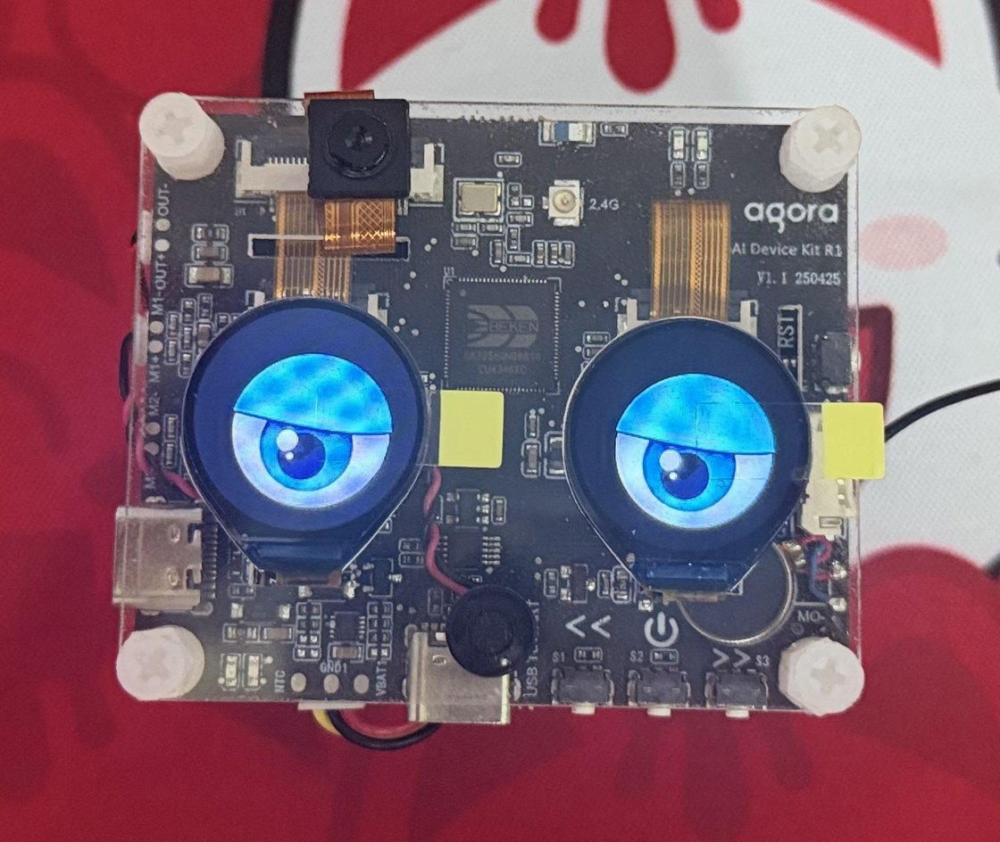
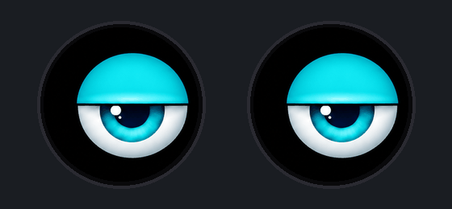
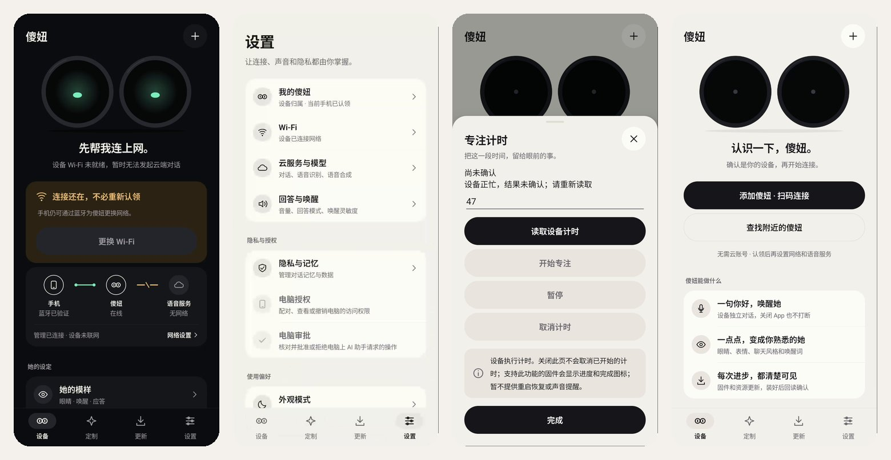
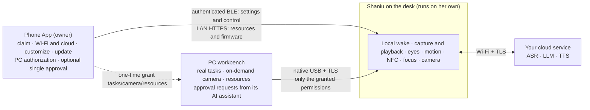
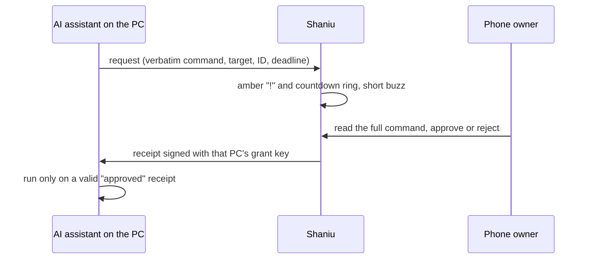
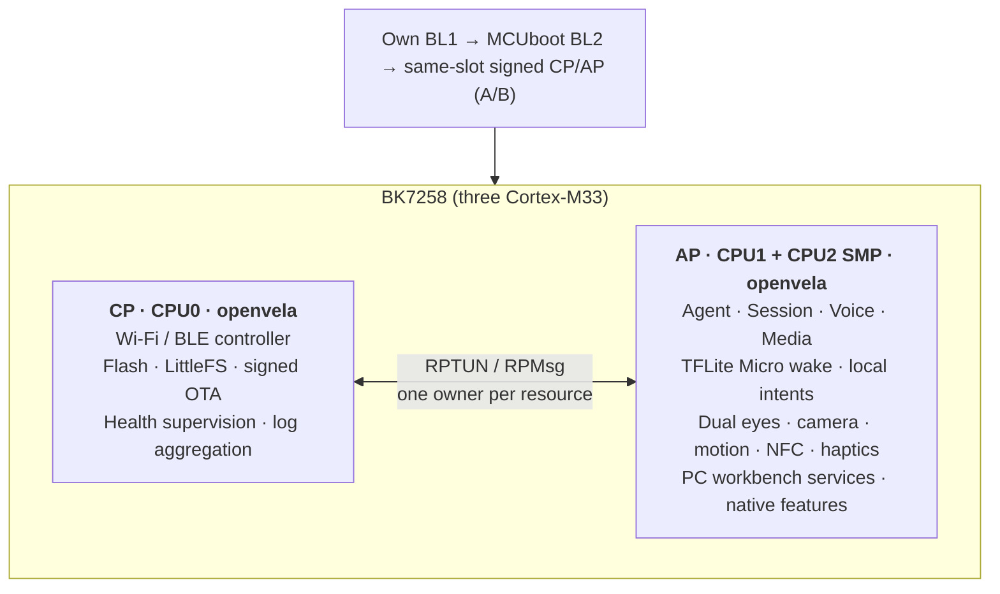

# Shaniu: an openvela AI companion that lives on your desk

[简体中文](README.md) · [Feature and evidence inventory (Chinese)](docs/platforms/bk7258/shaniu-feature-inventory.md) · [Hands-on and demonstration guide (Chinese)](docs/platforms/bk7258/shaniu-user-guide.md) · [Current board acceptance](boards/bk7258/CONFIGS.md) · [Android App](android/shaniu-companion/README.md) · [Build CLI](tools/bk7258/README.md) · [Technical report (Sep 20 snapshot, Chinese)](docs/contest/技术报告-BK7258三核适配与傻妞AI伴侣.md)

<p align="center">
  
</p>

Shaniu (傻妞) is an AI companion that sits on your desk. Say “你好，openvela”
(“hello, openvela”) and she goes online by herself to understand and answer you,
showing on two round eye displays whether she is listening, thinking or speaking.
She can look at something you hold up to her camera, react when you pick her up,
keep a focus timer, and receive the result of a long job running on your computer,
giving a short buzz when it finishes. The phone is only needed to claim her out
of the box, enter Wi-Fi and cloud settings, customize and update her. A computer
can hand her task results, or ask the phone owner to approve one command for its
AI assistant, only after the phone has authorized that computer once.

She runs on a **BK7258** tri-core chip: CPU0 runs the openvela CP instance for
radio, storage and updates; CPU1/CPU2 run the AP instance in SMP for voice,
display and the Agent. The same chip adaptation also serves two other boards;
T5-Board runs the Dolphin graphical tool.

Competition scope: **new hardware platform adaptation + AI hardware product innovation**, matching the [technical report](docs/contest/技术报告-BK7258三核适配与傻妞AI伴侣.md).

> **Reproduction and acceptance boundary.** First compare `git rev-parse HEAD`
> with the commit you downloaded, then check the build and independent delivery
> verification for that same commit in the official [Actions workflow](https://github.com/open-vela/contest2026_135_yongwangzhiqian/actions/workflows/shaniu-source-checks.yml).
> Those checks show that the pinned manifest builds development-identity-signed
> firmware and the App in a clean environment. The sole exception is the checked-in
> Agent Session history safety patch: it is applied only to a build-directory copy
> of a SHA-256-pinned upstream input, never to the shared checkout; see
> `SOURCE_PROVENANCE.md`. These checks are neither an author-signed
> release nor whole-device acceptance. Per-feature evidence is listed below and
> in the inventory; board-level conclusions live only in
> [CONFIGS.md](boards/bk7258/CONFIGS.md).

The November 4 review repairs are built and package-verified in App 59 and
firmware 778. Firmware 778 is the last board-accepted firmware: the real board
was discovered, reclaimed and connected over authenticated BLE with state
readback, and the user confirmed dialogue and camera use. Later PR #154
(`95a4dfef`) changed state cleanup in `bk7258_native_apps.c`, so current source
is not identical to the 778 build input; its host regression and CI cold build
(41868851257) passed, with no new board evidence. Those facts, hashes
and limits are recorded in the
[repair record](docs/verification/bk7258/2026-11-04-finals-review-repairs.md);
they are not OTA or power-loss-recovery acceptance.

The official template requires the project, direction, layout, run steps and AI Coding explanation; see the [contest overview](https://github.com/open-vela/docs/blob/dev-ai-contest-2026/zh-cn/contest_2026/contest_overview.md), [submission guide](https://github.com/open-vela/docs/blob/dev-ai-contest-2026/zh-cn/contest_2026/code_submission_guide.md), and [AI-log guide](https://github.com/open-vela/docs/blob/dev-ai-contest-2026/zh-cn/contest_2026/ai_coding_log_guide.md). Claude Code and Codex assisted design, implementation, diagnosis and documentation. Use [`logs/README.md`](logs/README.md) as the entry: historical exports retain collector label `lijian`, while this review's redacted additions are under `logs/Embracecactus/`; neither identity field is rewritten merely because the current GitHub username differs. Internal reasoning/context, media and sensitive payloads are excluded or redacted/hashed. The collector does not push automatically. All 211 sessions and 113,146 events pass the official schema validator; the log entry explains the public snapshots' completeness limits.

## What she can do today

Evidence levels, low to high: **implemented** → **host/emulator tested** →
**board observed** → **real phone** → **confirmed by a person**. Each row states
only the highest level reached and its version; an older firmware result does
not mean the current source passes.

| Capability | How you use it | Depends on | Highest evidence (date · version) |
| --- | --- | --- | --- |
| Local wake, continuous Q&A | Say “你好，openvela”, ask; follow up without re-waking after playback | Wake on device; ASR, answer and TTS need Wi-Fi and a cloud service | Board, full chain: Sep 20 · `18.6.401+638`. Nov 3: real-person wake matched locally twice, but the device lacked network/cloud settings, so the dialogue correctly did not start (`ENETDOWN`) |
| Local fixed commands | Volume, expression, “stop talking”, “start focus 25 minutes” | Cloud ASR still converts speech to text; a hit skips the LLM. The MIC is released during playback, so this is not acoustic barge-in | Host tests and AIDK build; new commands not board-accepted |
| Photo understanding | “看看这个，这是什么？” (“what is this?”) | Cloud multimodal model | Board: Sep 20 · 639 user-confirmed; color errors seen, no accuracy statistics |
| Eyes and status | Listening, thinking, speaking, offline states; installable eye packs | Local | Board: 641 two packs persisted across reset; Nov 3 expression render/readback |
| Motion expressions; completion buzz | Pick her up or tilt her; a short buzz when focus or a PC task finishes | Accelerometer and motor | Board: Nov 3 samples and two driver returns of 0; pickup reaction and feel not yet confirmed by a person |
| Focus timer | Start/pause/resume/cancel by voice, App, NFC card or PC | Local timer | Emulator and host tests; voice entry not board-accepted |
| NFC scene cards | Register a card in the App for focus, local content or launching a feature, then tap | MFRC522; ISO14443A UID cards | Emulator drafts; board no-card scan `-110`; no real-card trigger yet |
| Fact memory | Enable memory, “记住我叫……” (“remember my name is…”); view/correct/delete in the App | Encrypted on the device | Real phone + board: Nov 1 add/correct/delete/reboot readback |
| Runtime Skills | “专注助手：……” and two other scene prefixes | Cloud Agent; external Skills must be signed | Real phone + board: Nov 1 enable/disable persisted |
| PC task feedback | `workbench task-run` runs a real command; the result goes to Shaniu | Native USB; `tasks` grant from the phone | Board: Nov 3 success and timeout receipts confirmed; screen/buzz not confirmed by a person |
| On-demand PC camera | Browser workbench: capture one frame, save, cancel, recapture | Native USB; `camera` grant | Board: Nov 3 two 640×480 frames, [55 s real-speed recording](docs/verification/bk7258/2026-11-03-feature-validation/videos/board/camera-capture-cancel-recapture.mp4) |
| Single-use phone approval | The PC's AI assistant requests a command; Shaniu shows “!”; the phone owner approves or rejects | Claimed phone; PC already holds `tasks` | Host tests; Nov 3 board + phone: approved command ran (author's local screen recording; receipt approved, authenticated=true, exit code 0), unattended request expired and nothing ran; reject not yet tested |
| Claim, Wi-Fi, settings | Scan the code on her screen; enter Wi-Fi and cloud settings over authenticated BLE | Phone; claiming needs no internet | Historical: 637/641 claim, Oct 18 and Nov 1 Mi 10 sessions, plus App 58 read-only cloud-setting readback. Current: `0.7.132+778` and App 59 completed discovery, reclaiming, authenticated control connection and state readback; the user confirmed dialogue and camera use. This excludes App OTA and board power-loss-recovery acceptance |
| Resource and wake-model updates | Install eye packs (Wi-Fi) and switch/import wake models (BLE) from the App | Phone and device on the same LAN | Board: 641 install and reset persistence |
| App firmware update (OTA) | Pick a `.bkpack`; the device pulls it over Wi-Fi and verifies after reboot | Matching signing trust and rollback counter | Board: 634 first real OTA; 767 reconnect after update passed; 770 updated but automatic reconnect failed |
| Signed native features | “帮我做个决定” (“help me decide”); install first-party signed packages from the App | Product firmware needs a publisher key fingerprint | Host tests; **the product configuration's fingerprint is empty, so release firmware rejects installation** |
| Keys | K1/K3 volume; hold K2 alone ≥3 s and release to request power-off | Local | Volume keys: 638 board; K2 power-off not separately accepted. Factory reset only through the authenticated App |

<p align="center">
  
  <br><sub>Rendered from the repository eye pack <code>shaniu-cyan-v2</code> and the drawing rules in <code>bk7258_focus_pixels.h</code>; an illustration, not a board recording.</sub>
</p>

## Real demonstrations

- **Board video (2026-09-20)**:
  [main video 4:48](https://github.com/Embracecactus/contest2026_135_yongwangzhiqian/releases/download/shaniu-demo-20260920/shaniu-demo.mp4)
  · [App video 1:26](https://github.com/Embracecactus/contest2026_135_yongwangzhiqian/releases/download/shaniu-demo-20260920/shaniu-app-demo.mp4)
  · [Bilibili BV1pueq6hEzQ](https://www.bilibili.com/video/BV1pueq6hEzQ/)
  · [subtitles and hashes](https://github.com/Embracecactus/contest2026_135_yongwangzhiqian/releases/tag/shaniu-demo-20260920).
  The App video only shows the OTA entry.
- **Board camera (2026-11-03)**: a [55 s real-speed screen recording](docs/verification/bk7258/2026-11-03-feature-validation/videos/board/camera-capture-cancel-recapture.mp4)
  of the PC workbench taking real frames from the device camera; no ambient sound, dark image.
- **App emulator recordings (2026-11-03)**: 14 passing groups and 4 failure
  diagnostics with fixture data, in the [feature validation record](docs/verification/bk7258/2026-11-03-feature-validation/README.md#手机模拟器录像).
  An emulator proves nothing about real Bluetooth, NFC, sound or OTA.

<p align="center">
  
  <br><sub>Android App <code>0.7.27</code> on the emulator (fixture state); the latest recorded real phone App is <code>0.7.29-shaniu-finals-fixes</code> / code 59.</sub>
</p>

## Finals presentation and film sources

[PPT](https://github.com/open-vela/contest2026_135_yongwangzhiqian/releases/download/shaniu-finals-20261104/shaniu-finals-20261104.pptx) · [PDF](https://github.com/open-vela/contest2026_135_yongwangzhiqian/releases/download/shaniu-finals-20261104/shaniu-finals-20261104.pdf) · [4K 实录合集](https://github.com/open-vela/contest2026_135_yongwangzhiqian/releases/download/shaniu-finals-20261104/shaniu-finals-demo-4k-20261104.mp4) · [《我在》完整版](https://github.com/open-vela/contest2026_135_yongwangzhiqian/releases/download/shaniu-finals-20261104/我在-v3.1-板载应答音-中文字幕版.mp4)

The [presentation workspace](docs/contest/答辩材料/README.md) contains the PPT generator,
speaker notes, Q&A and source records. [Here I Am / 我在 v3.1](docs/contest/答辩材料/产品影片/v3-wozai/README.md)
includes Claude's Three.js scenes, character models, screenplay, storyboard, feature map and subtitles.
The latest 9:38 delivery preserves the picture and burned-in Chinese captions and replaces nine wake
replies with the device's source audio; appendix Q links to this version. The
[4K demonstration compilation](docs/contest/答辩材料/决赛演示视频/motion-4k/README.md) has editable sources too.

The film is a fictional dramatization, not hardware acceptance evidence. Finished videos, PPT/PDF,
the organizer's template and private audio are supplied through the official repository Release and the contest form.
Exact delivered-file identities are in the [delivery manifest](docs/contest/答辩材料/delivery.json).

## Who does what: device, phone, computer



**Why do some computer operations need the phone?** Most do not. The PC is
authorized once by the phone; afterwards builds, training or rendering run with
`task-run` hand their results straight to Shaniu. The single-use approval is a
separate, optional gate for commands you want to check yourself, for example
before the coding assistant on your PC runs `git push` (`workbench approval-run`,
or a Claude Code `PreToolUse` hook). The decision lives on the phone because it
holds the owner credential from claiming and can show the whole command verbatim;
anyone can touch the device on the desk, and a round eye display cannot show a
full command. **Starting a computer operation by voice is not implemented.**



## First use

1. **You need** Shaniu (AIDK AI Toy board in its clear enclosure, USB power), an
   Android 10+ phone, 2.4 GHz Wi-Fi and your own cloud account (MiMo standard API
   or Token Plan by default). No author credentials are shipped.
2. **Install the App** from source (below) or a published APK. If an older App is
   installed, check signature compatibility first; uninstalling or clearing data
   deletes the claim credential.
3. **Claim**: Device → “添加傻妞 · 扫码连接” (add Shaniu, scan to connect), scan the
   code on her screen. No internet is needed; the result is read back from the device.
4. **Connect**: let the device scan Wi-Fi; enter the password and the cloud
   endpoint, API key and models. Secrets are never read back.
5. **Talk**: say “你好，openvela”.

The full factory first-boot identity and claim-code path has not been accepted
on a new board yet.

## Daily use

- **Talking**: after waking, ask naturally; follow up before the silence timeout.
  Answer length, thinking, model, volume and speed are App settings that survive reboot.
- **Local commands** (matched on the device after ASR, no LLM request): volume
  0–100, expressions, stop/cancel, focus start/pause/resume/remaining, launching
  an installed native feature. Negations, conditions, questions and multiple
  intents go to the Agent instead.
- **Without network**: wake detection, eyes, keys, motion expressions, NFC cards,
  local content and the focus timer keep working; ASR, answers, TTS and photo
  understanding need the network and fail honestly without it.
- **Keys**: K1/K3 volume down/up; hold K2 alone for at least 3 s and release to
  request power-off, press K2 to power on. Factory reset only in the authenticated App.

## Customization and updates

| Content | File | Channel | Counted as applied when |
| --- | --- | --- | --- |
| Eye expressions | `.bkep` ([how to build](app/bk7258/assets/display/README.md)) | Phone-hosted HTTPS over Wi-Fi | The device reads back matching `pack_id`, `revision`, `source_sha256` |
| Default expression and timed trial | Installed resources | Authenticated BLE or PC workbench (`resources`) | Device readback |
| Wake model | `.wkm` (three bundled in the App) | Authenticated BLE in chunks | Readback of active model SHA, label and phrase |
| Runtime Skill | Signed JSON ([packing](tools/bk7258/README.md#runtime-skill-packages)) | App imports publisher key and package | Device verifies; disabled after install |
| Native feature | Signed `shaniu.native/1` | App install | Device verification and anti-rollback; rejected until the product fingerprint is set |
| Firmware | Signed `.bkpack` OTA | App submits the source; device pulls over LAN HTTPS | After reboot: version, counter, active slot and `pair=confirmed` |

## Architecture



| Physical board | Build ID | Role | CP/AP SDK |
| --- | --- | --- | --- |
| AIDK AI Toy (AIToyBoard) | `aidk_ai_toy` | Shaniu | `cp-aidk + ap-aidk` |
| T5-Board V1.0.2 | `t5_board` | Dolphin graphical tool | `cp + ap` |
| Tuya T5AI-Core V1.0.1 | `t5ai_core` | Minimal-system baseline | `cp + ap` |

Engineering highlights: a source-built BL1 and packer (32-byte data + 2-byte CRC
Flash encoding) with MCUboot and paired CP/AP updates (first real App OTA at
634); RPMsg temporary threads replaced by resident workers (ENOMEM at run 53 →
80 clean runs); native ELF loading confined to CPU0 after a CPU1 cross-core lock
problem (100 + 100 cycles pass, root cause not claimed fixed); the SDK “OPP
320M” label found to mean 160 MHz on CPU0 (CoreMark 561.58 at 240 MHz on the
T5-Board performance profile, 10 runs). Details: [technical report](docs/contest/技术报告-BK7258三核适配与傻妞AI伴侣.md)
and [dated verification records](docs/verification/bk7258/).

## Wake word and voice

- Built-in model: 32-channel full-INT8 DS-CNN, 23,640 B, TFLite Micro, ~80 ms
  per inference, evaluated every 300 ms, two consecutive hits, 1 s cooldown,
  default threshold 0.60 (App range 50–90%).
- Training: `bk7258.py voice kws audit/train/evaluate` with source isolation and
  quantization alignment. Several rounds improved a synthetic held-out set
  (127/400 → 318/400 in one round) but regressed on others; **no candidate
  replaced the product model**, and there is no multi-speaker human FAR/FRR result.
- TTS: on the same board and input, MiMo SSE (first PCM 1,227–1,344 ms, max gap
  531–697 ms) was kept over Tencent Cloud WebSocket (1,605–1,682 ms, gaps
  3,863–7,607 ms, one timeout in three); five samples only, not a ranking.
- The AIDK product configuration currently plays the contest-period authorized
  “我在” recording (`CONFIG_BK7258_AIDK_PRIVATE_WAKE_REPLY_PCM=y`); a public
  synthetic alternative is documented in [WAKE_REPLY_PUBLIC.md](app/bk7258/assets/WAKE_REPLY_PUBLIC.md).

## Tests and evidence

| Layer | Entry | Latest result |
| --- | --- | --- |
| BK7258 host | `make -C tests/host/bk7258 check`, `run-shaniu-contracts` | Nov 3 local: 996 contract cases PASS (GCC 11); 104 headers × CP/AP × C11/C++17. The Nov 4 PR #148 cold build collected 999 PASS, a historical result of that CI run |
| Android | `./gradlew :app:testDebugUnitTest :app:lintDebug` | 345 distinct JVM cases passed (union of runs); lint 0 errors. App 59 build, unit-test and installation boundaries are in the Nov 4 repair record |
| Android emulator | instrumentation `ui_gallery` / `ui_probe` | 14 scenario groups, including 11 provisioning errors; fixture state |
| Firmware build | `bk7258.py build --board aidk_ai_toy` | Product, native-loader and CSI diagnostic direct builds pass |
| Cold CI | [`Shaniu cold delivery`](https://github.com/open-vela/contest2026_135_yongwangzhiqian/actions/workflows/shaniu-source-checks.yml) | See “CI review” below |
| Board | [dated records](docs/verification/bk7258/) | Latest: [Nov 4 repairs, 778/App 59 deployment and acceptance boundary](docs/verification/bk7258/2026-11-04-finals-review-repairs.md); the Nov 3 validation remains historical video evidence |

## Reproduce from source

| Level | Guaranteed | Notes |
| --- | --- | --- |
| Same source and configuration | Yes | The team manifest pins dependencies, the SDK and the toolchain; the sole derived build input is the SHA-256-pinned Agent Session history safety patch |
| Equivalent behavior | Expected | Still needs acceptance on your board |
| Byte-identical unsigned payloads | Not verified | Raw image hashes from two independent environments have not been compared |
| Byte-identical signed images | No | Different signing keys; private keys, device identity, calibration and cloud credentials are not public inputs |

A debug APK you build has your debug signature and **cannot update** the
author-signed App in place; uninstalling loses the Keystore claim credential.
Your development signing identity (or the ephemeral one CI creates) is **not
accepted** by the author's board, whose BL1/MCUboot trust root is another key.

**Environment**: x86_64 Linux (CI uses Ubuntu 24.04, the author Ubuntu 22.04),
network access to GitHub/PyPI/Google Maven, `git`, Google `repo`, `make`,
`gcc`, `g++`, `cmake`, `openssl`, `libssl-dev`, `zip`, `unzip`, Python 3.10, JDK 17, Android SDK Platform 35
(Gradle 8.13 via the wrapper). No board, cloud account, author key or training data.
Full host checks also need `pkg-config` and `libcmocka-dev`. Configure the installed Android SDK
in the same shell, for example `export ANDROID_HOME="$HOME/Android/Sdk"` (replace with your own
installation path), and check that `$ANDROID_HOME/platforms/android-35/android.jar` exists.
Alternatively set `sdk.dir` in the App's local `local.properties`. The contract suite includes
Android JVM/TLS tests and needs this SDK configuration too.

Run the commands from the Chinese README section
[“从源码复现”](README.md#从源码复现) in a **new empty directory** (not under an
existing repo client): `repo init` with `-m contest2026_135_yongwangzhiqian.xml
-g default,bk7258-sdk,platform-linux`, a local manifest that pins the team
project to the manifest commit, the bounded `repo sync` list used by CI, then
`toolchain install/verify`, `sdk rebuild/verify` for `cp-aidk` and `ap-aidk`,
`identity init --development`, `build --board aidk_ai_toy --boot mcuboot
--development-identity --rollback-floor 1`, `release full ... --factory-init`,
`verify package` and `verify trust`; then `./gradlew :app:assembleDebug
:app:assembleDebugAndroidTest :app:testDebugUnitTest` in
`android/shaniu-companion`. Without board data the release states
`same-device-hardware-data-required`: **there is no 8 MiB image for arbitrary boards**.

The Android commands run in a subshell in that sequence, so the following host-test
commands run again from the team-project root:

```bash
(
  cd android/shaniu-companion
  ./gradlew :app:assembleDebug :app:assembleDebugAndroidTest :app:testDebugUnitTest
)
```

**Packaging and independent verification.** `release full --factory-init` without an
accepted same-device base produces independently signed factory software, not a
complete-flash product delivery ZIP. Follow the Chinese README's
[packaging section](README.md#打包交付物与独立核验) to create the CI-shaped review
archive (firmware, debug APK, pinned manifest, public build evidence and
`SHA256SUMS.txt`) and verify it after unpacking with `sha256sum`, `verify package`,
and `verify trust`. That archive is deliberately not passed to `verify delivery`.

The CLI-verified `product delivery ZIP` is a separate, board-bound artifact. Only
with an accepted readback and evidence from **your own same board**, rerun `release
full` with `--base` and `--base-evidence`, then run:

```bash
python3 tools/bk7258/bk7258.py release full --build-manifest "$build_manifest" \
  --development-identity --version 0.7.0+1 --product shaniu \
  --artifact-id my-own-board-build --factory-init \
  --base <own-base.bin> --base-evidence <own-accepted-base.json> \
  --output-dir ../out/shaniu-own-full
python3 tools/bk7258/bk7258.py release product \
  --full-release ../out/shaniu-own-full --base <own-base.bin> \
  --openssl /usr/bin/openssl --output ../out/shaniu-own-product.zip
python3 tools/bk7258/bk7258.py verify delivery \
  --delivery ../out/shaniu-own-product.zip --openssl /usr/bin/openssl
```

`verify delivery` verifies the ZIP's package, build manifest, accepted-base evidence
and full recovery image. It neither authorizes flashing another board nor proves App,
voice, BLE, OTA, or whole-device acceptance. The official CI separately verifies
source/manifest identity using its GitHub event context; do not fabricate that event
locally.

**CI review.** Every push to official `dev-ai-contest-2026`, including documentation, logs and materials, triggers cold delivery; PR and manual triggers remain. PR builds reuse the verified Actions candidate through a local Git mirror so merging the PR cannot remove the ref needed by the ongoing sync. The manifest retains the public repository URL and exact commit, and the candidate base/head parents are checked.

The workflow uses an ephemeral development identity and does not
create a package trusted by the author's board or any existing device. Before
using an artifact, record `git rev-parse HEAD` and check the build and
`verify-delivery` conclusion for that exact commit in the [official workflow](https://github.com/open-vela/contest2026_135_yongwangzhiqian/actions/workflows/shaniu-source-checks.yml).
Artifacts expire after seven days.

**Author-signed release.** Determine whether one corresponds to the selected
commit from the Release page, `SHA256SUMS`, and the source commit in
`source-inputs.json`. The
[2026-09-20 firmware comparison package](https://github.com/open-vela/contest2026_135_yongwangzhiqian/releases/tag/shaniu-firmware-20260920)
(`18.6.401+641` images without device data and APK `0.5.23`) is historical. The
old serial provisioning and same-device recovery flow is preserved in the
[preliminary review snapshot (Chinese)](docs/contest/初赛评审流程与实测快照-20260920.md).

## Limits and roadmap

Not yet done: whole-device, all-feature acceptance of the current source. The
`0.7.129+775` approval-display result is historical and bounded. `0.7.132+778`
and App 59 completed download, initialization, discovery, reclaiming,
authenticated control and state readback, and the user confirmed dialogue and
camera use. Still open: phone reject; real NFC cards; motion and haptic feel;
App OTA and board power-loss recovery; native feature installation (publisher fingerprint). Unmeasured: power
and battery life, long-term stability, multi-speaker wake rate, acoustics (no
echo cancellation; half-duplex), BOM cost. The enclosure is the kit's clear
acrylic sandwich, a prototype. Next: complete the board checks above, choose the
first-party publisher identity, run OTA-reconnect and stability campaigns,
collect human wake data, then power, enclosure and production provisioning.

## Repository map

`chips/bk7258/` and `boards/bk7258/` (chip mechanisms, three boards) ·
`app/bk7258/` and `app/dolphin/` (product services, Dolphin) ·
`android/shaniu-companion/` · `tools/bk7258/` (the only build/release/workbench
CLI) · `tests/host/bk7258/` · `nuttx/`, `frameworks/` ·
[`docs/platforms/bk7258/`](docs/platforms/bk7258/README_EN.md) and
[`docs/chips/bk7258/`](docs/chips/bk7258/README.md) (platform layers and chip
mechanisms) · `app/hello_app/`, `quickapp/hello_quickapp/` (organizer starter
scaffolds) · `contest2026_135_yongwangzhiqian.xml`, `.github/workflows/cla.yml`
(manifest and CLA scaffolds) · [`docs/`](docs/README_EN.md) ·
[`logs/`](logs/README.md) (AI Coding log entry and identity/privacy boundary).

Gateway is retired and is not a current build, installation, or product entry.
Its historical source and acceptance record remain at the fixed
[e4f2df71 snapshot](https://github.com/open-vela/contest2026_135_yongwangzhiqian/blob/e4f2df717defab9f6ad02adc662acd8cba086cf2/gateway/shaniu/README.md),
which this documentation does not restate or update.

Original code is [Apache-2.0](LICENSE); third-party code, SDK, models and
generated assets are listed in [SOURCE_PROVENANCE.md](SOURCE_PROVENANCE.md).
Cloud credentials, private keys, private voices and device-bound recovery data
are not distributed.
