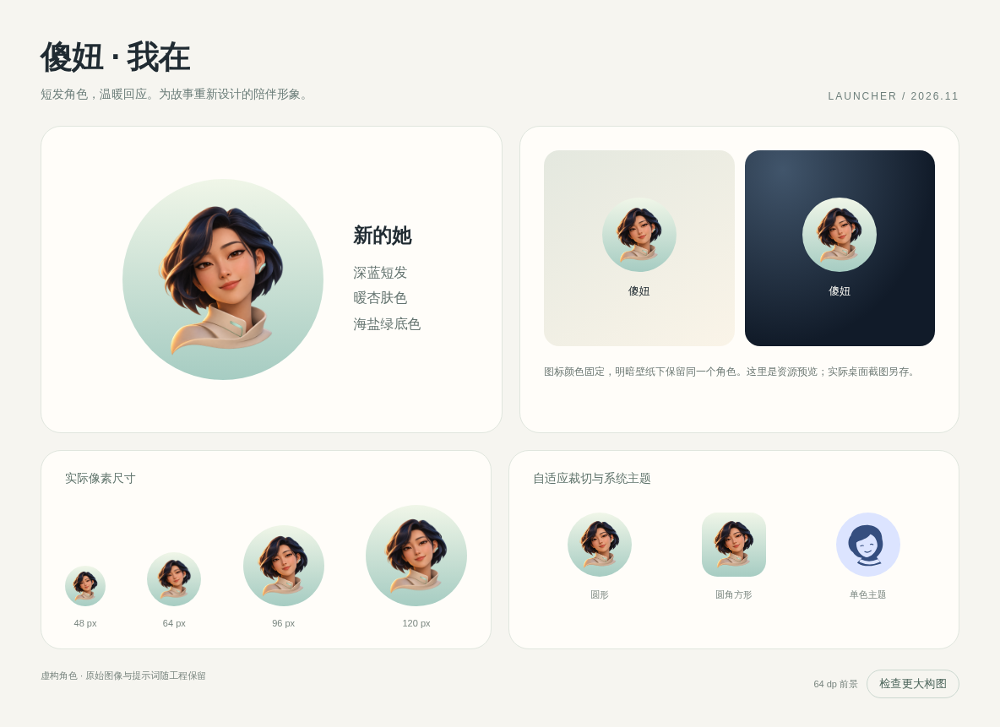

# 傻妞启动图标：我在

短发陪伴角色以深蓝头发、暖杏肤色、象牙白衣领和海盐绿底色表达“我在”。她是按文字
生成的虚构成年角色，没有真人照片参考。这个静态品牌形象与 App 内负责设备状态的
双眼界面各有职责。



- [透明原图](artwork/response-character.png)，可供动画延续同一角色形象。
- [完整生成提示词](PROMPTS.md) 与 [原图 SHA256](artwork/manifest.json)。
- [交互预览](preview.html)，可直接在浏览器打开。

## Android 资源

路径相对 `android/shaniu-companion/`：

| 文件 | 用途 |
| --- | --- |
| `app/src/main/res/mipmap-anydpi/ic_launcher.xml` | 自适应图标及单色主题入口 |
| `app/src/main/res/drawable-nodpi/shaniu_launcher_response.webp` | 512×512 透明前景，143,400 bytes |
| `app/src/main/res/drawable/ic_launcher_foreground.xml` | 每侧按 22/108 比例留白 |
| `app/src/main/res/drawable/ic_launcher_background.xml` | 固定海盐绿渐变 |
| `app/src/main/res/drawable/ic_launcher_monochrome.xml` | 可编辑的短发、衣领与表情矢量层 |

按 [Android 自适应图标规范](https://developer.android.com/develop/ui/compose/system/icon_design_adaptive)
分离前景、背景与单色层。前景每侧使用 20.37037%（22/108）留白，随 Launcher 的实际
绘制尺寸缩放；不使用会在较小画布中缩小头像的固定 dp 留白。图标的强不透明轮廓
处于 108dp 设计网格的中央 66dp 安全圆内。

原图在仓库中完整保留。发布资产由以下命令导出：

```sh
ffmpeg -i design/launcher-20261104/artwork/response-character.png \
  -vf scale=512:512:flags=lanczos -c:v libwebp -lossless 1 \
  -compression_level 6 -frames:v 1 \
  app/src/main/res/drawable-nodpi/shaniu_launcher_response.webp
```

`monochrome-preview.svg` 由当前 Android 单色 XML 的路径和变换生成，供浏览器展示；
调整单色资源时应同步刷新该预览。原图、XML 和提示词是编辑来源，预览不代替实际系统
渲染。

## 验证

在 `android/shaniu-companion/` 执行：

```sh
./gradlew :app:assembleDebug :app:lintDebug
```

同一组图标资源已在 Android 16 模拟器的 Pixel Launcher 彩色应用列表中检查，
采用保留数据的覆盖安装。圆形、圆角方形与单色浏览器预览已检查；单色系统主题和
其他厂商桌面的实体手机效果未在本轮验证。构建检查不代表设备连接功能验收。
