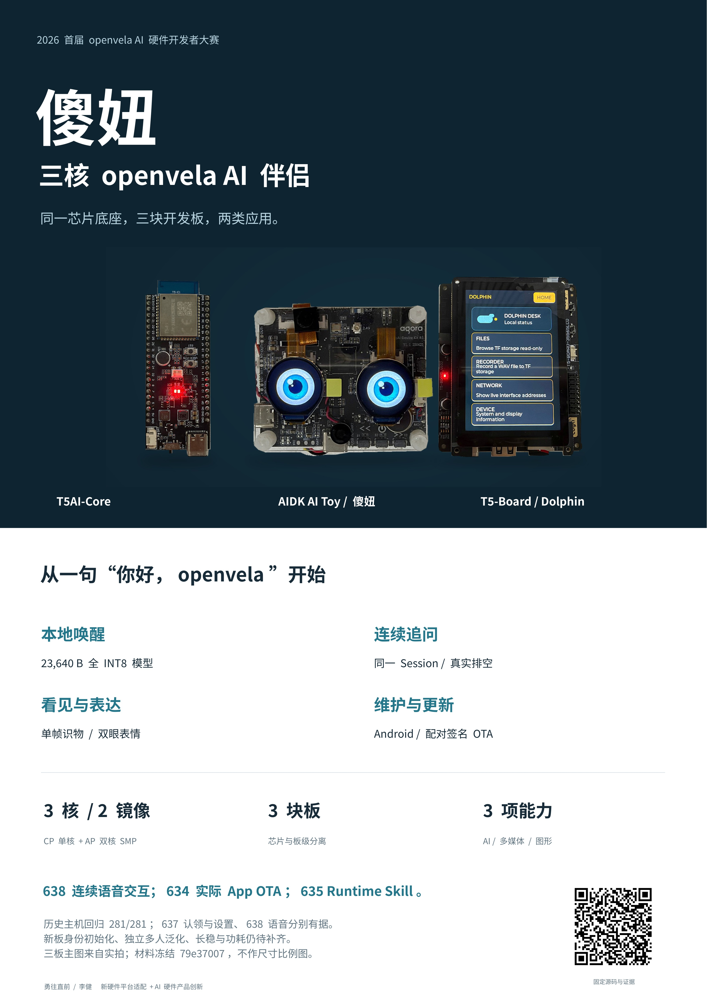

<!-- SPDX-License-Identifier: Apache-2.0 -->
# 初赛评审流程与实测快照（2026-09-20）

> **历史快照，不是当前操作入口。** 本文原样保留 2026-11-03 之前仓库 README 中的
> 初赛材料、评审操作流程、9 月 20 日实机验收状态、历史构建指南与实测表，
> 供追溯当时的版本、哈希和判断依据。其中的串口身份供给、`bkdata init`、
> 同板恢复镜像等步骤属于旧版维修路径；当前的使用、构建与复现入口见
> [仓库 README](../../README.md)，板级当前结论见 [CONFIGS.md](../../boards/bk7258/CONFIGS.md)，
> 各能力的证据层级见[功能与证据清单](../platforms/bk7258/shaniu-feature-inventory.md)。
> 下文的相对链接已按本文件位置改写（一处已失效的锚点改指现行章节），正文未改。

## 比赛材料

**决赛（11-04 截止上传，11-07/08 答辩）：** 提交清单、答辩要求和可直接粘贴的
“初赛后主要更新”见 [决赛提交与初赛后更新](../../docs/contest/决赛提交与初赛后更新.md)。

本地决赛修订版（PPTX、PDF、讲稿、时间预算、来源及拍摄清单）和原稿/官方模板
均保留在工作区，经表单上传，**不随仓库发布**。修订版为 12 页主讲加 3 页隐藏备查，
第 3 页内嵌上述 55 秒实板录像；PDF 仅作静态备份。

[已发布的提交包](https://github.com/Embracecactus/contest2026_135_yongwangzhiqian/releases/tag/shaniu-demo-20260920)
**已更新为 v5.1 材料**（2026-09-20，技术报告事实冻结 `6a8a3e55`）：

- 技术报告 v5.1：[PDF](https://github.com/Embracecactus/contest2026_135_yongwangzhiqian/releases/download/shaniu-demo-20260920/shaniu-technical-report-v5.1.pdf)（`ffd03de2…`）
  · [DOCX](https://github.com/Embracecactus/contest2026_135_yongwangzhiqian/releases/download/shaniu-demo-20260920/shaniu-technical-report-v5.1.docx)（`4aee7453…`）；
  Markdown 与配图见仓库 [技术报告](../../docs/contest/技术报告-BK7258三核适配与傻妞AI伴侣.md)；
- A2 海报 v5：[JPG](https://github.com/Embracecactus/contest2026_135_yongwangzhiqian/releases/download/shaniu-demo-20260920/shaniu-poster-a2-v5.jpg)（`0bb5231c…`）
  · [PDF](https://github.com/Embracecactus/contest2026_135_yongwangzhiqian/releases/download/shaniu-demo-20260920/shaniu-poster-a2-v5.pdf)
  · [PPTX](https://github.com/Embracecactus/contest2026_135_yongwangzhiqian/releases/download/shaniu-demo-20260920/shaniu-poster-a2-v5.pptx)；
- 答辩 PPT v5.1：[PDF](https://github.com/Embracecactus/contest2026_135_yongwangzhiqian/releases/download/shaniu-demo-20260920/shaniu-defense-v5.1.pdf)
  · [PPTX](https://github.com/Embracecactus/contest2026_135_yongwangzhiqian/releases/download/shaniu-demo-20260920/shaniu-defense-v5.1.pptx)；
  实物照片册 v5：[PDF](https://github.com/Embracecactus/contest2026_135_yongwangzhiqian/releases/download/shaniu-demo-20260920/shaniu-photo-book-v5.pdf)
  · [PPTX](https://github.com/Embracecactus/contest2026_135_yongwangzhiqian/releases/download/shaniu-demo-20260920/shaniu-photo-book-v5.pptx)；
- 视频：[主视频 287.905 s](https://github.com/Embracecactus/contest2026_135_yongwangzhiqian/releases/download/shaniu-demo-20260920/shaniu-demo.mp4)
  与 [App 补充视频 85.612 s](https://github.com/Embracecactus/contest2026_135_yongwangzhiqian/releases/download/shaniu-demo-20260920/shaniu-app-demo.mp4)（各含 `.srt`，未重编码）；
- 校验：[v5.1 材料 SHA256](https://github.com/Embracecactus/contest2026_135_yongwangzhiqian/releases/download/shaniu-demo-20260920/shaniu-materials-v5.1-SHA256SUMS.txt)
  与[视频 SHA256](https://github.com/Embracecactus/contest2026_135_yongwangzhiqian/releases/download/shaniu-demo-20260920/SHA256SUMS.txt)；
  被 v5.1 取代的旧 `shaniu-technical-report.pdf/docx` 已从该 Release 移除。
- **`shaniu-submission-…zip`（331 MB）仍是 2026-09-19 快照**（内含旧版报告、海报与
  PPT）；v5.1 整包 ZIP 尚未重打包，需要整包时以上列单文件为准。

仓库内的海报图也已同步为 v5：`docs/contest/assets/showcase-poster.jpg`
（`0bb5231c567e995231363d750e44be76b46faa9a0c8f1e40f699d751f4ea99ce`）。
源码与原始 AI Coding 日志留在仓库，不塞进材料 ZIP；公开包不含设备授权秘密与同板
恢复镜像，照片均为真实拍摄，未虚构背面或侧面视角。

[](https://github.com/Embracecactus/contest2026_135_yongwangzhiqian/releases/tag/shaniu-demo-20260920)

压缩包按大赛模板命名。仓库内的技术报告已更新为**材料版本 v5.1**（2026-09-20，
事实冻结 `6a8a3e55`，配图随 `docs/contest/assets/report-v5/` 提供，只补正
639/641、首装入口与资源交付事实）；已发布的材料 ZIP 内 PDF/DOCX/PPT 仍是
2026-09-19 生成的那一版（早于 637/638 与 639/641 的结论），未按 v5.1 重新打包上传，
本页与仓库文档的更新不代表这些附件已同步。

[固件对比包与 App 安装包](https://github.com/Embracecactus/contest2026_135_yongwangzhiqian/releases/tag/shaniu-firmware-20260920)
提供 2026-09-20 实机固件 `18.6.401+641` 的**去设备数据镜像**（CP/AP/pair/boot/BL2/manifest）、
构建证据、debug APK、两只成品眼睛包与三份唤醒模型，全部列出 SHA256。
同一份包也发布在官方赛事仓
（[open-vela Releases](https://github.com/open-vela/contest2026_135_yongwangzhiqian/releases/tag/shaniu-firmware-20260920)，
tag 指向合并提交 `6a8a3e55`），fork 与官方仓两份资产 SHA256 一致。
**operator 8 MiB 全镜像与 full `.bkpack` 不在其中**：它们含本机
`payloads/persistent_data.bin`（设备 TLS 身份私钥、本机配网凭据、云服务凭据），
公开发布等于泄露这些凭据；需要可烧录整包的评委请按下一节用自己板子的整片读回物化。


## 历史赛事版评审流程（非当前候选操作入口）

本节保留赛事期操作记录，**不是当前候选的操作入口**；当时每项输入的来源、消费者、安装位置与成功判据见
[首次部署输入清单](../../docs/platforms/bk7258/first-deployment-inputs.md)（下称“输入清单”）。
命令以 openvela 工作区为根目录执行，团队仓目录为 `contest2026_135_yongwangzhiqian/`。
例子与已完成证据分开标注：**已实测**的步骤引用具体版本与哈希，**未实测**的步骤明确写出。

### 0. 先读三条边界

1. **烧录镜像绑定设备**：`release full` 产出的 operator 由**同板 readback** 物化，
   含该机的绑定数据，只对同一台设备有效；评委的板必须用自己的 readback 走一次
   `package accept-base`，不能烧作者的包。
2. **首次存储初始化必须显式执行**：固件启动只 `mount -t littlefs`，从不自动
   格式化；`persistent_data` 不是 LittleFS 的板在 NSH 执行
   `bkdata init --confirm erase-non-littlefs`（只对非有效 LittleFS 的内容格式化），
   随后重启。语义与判据见输入清单第 6 节；该命令**尚未在新板实测**。
3. **身份写入与 App 认领是两件事**：设备 TLS 身份（BPI1）由 CP `bkprov supply`
   写入，随后 App 用同一份 `owner-bootstrap.json` 完成 BLE 认领与配网。

### 1. 识别板型与设备初始状态

- 产品板：AIDK AI Toy（稳定的 machine ID `aidk_ai_toy`），CH340 Type-C 走 UART0 控制台
  （115200 8N1），`--fast-link 1` 必需；native Type-C 不是原始 Flash 通道。
- 判断设备是“正常运行板”还是“空白/擦除板”：
  - 正常板：串口有 NSH 提示符，可执行 `bkprov status` 读身份状态；
  - 空白板：**不能**依赖 `reset reboot`（没有运行中的固件）；按住 K1 再上电/
    复位进入 Boot ROM 窗口，或在 loader 打印 `Getting Bus` 时按一下 K1。
- 主机 COM 号是现场状态，不要写死 `COM8`；供应时先关闭其他串口占用者。

### 2. 准备主机、工具链、SDK 与源码

```bash
repo init -u https://github.com/open-vela/contest2026_135_yongwangzhiqian \
  -b dev-ai-contest-2026 -m contest2026_135_yongwangzhiqian.xml -g default,bk7258-sdk
repo sync -c -j8
cd contest2026_135_yongwangzhiqian

tools/bk7258/bk7258.py toolchain install
tools/bk7258/bk7258.py toolchain verify
tools/bk7258/bk7258.py sdk rebuild --profile cp-aidk --source ../vendor/beken/bk_avdk_smp --jobs 8
tools/bk7258/bk7258.py sdk rebuild --profile ap-aidk --source ../vendor/beken/bk_avdk_smp --jobs 8
tools/bk7258/bk7258.py sdk verify --profile cp-aidk
tools/bk7258/bk7258.py sdk verify --profile ap-aidk
```

判据：`toolchain verify` 与 `sdk verify` PASS。AIDK 必须成对使用 `cp-aidk + ap-aidk`；
其他两板的 profile 组合见[板型配置](../../boards/bk7258/CONFIGS.md)。

### 3. 准备公开模型、应答音与显示资源

| 资源 | 位置 / 大小 / SHA256 | 说明 |
| --- | --- | --- |
| 内置唤醒模型 | `app/bk7258/models/nihao_openvela.tflite`，23,640 B，`922eba9175fcda60…` | 随源码分发；配置期与运行期双重 SHA 校验；评委不需要训练环境 |
| 唤醒应答音 | `app/bk7258/assets/wake_reply.pcm`，31,208 B，`772a8aa9…` | 比赛期入库的私有授权录音，赛后删除；离线 PCM，设备本地播放 |
| 眼睛素材源 | `app/bk7258/assets/display/shaniu-cyan-v2.json`（+ PNG 1,048,307 B） | 生成 `.bkep` 后由 App 安装；638 实机为 `pack=shaniu-cyan-v2 revision=2` |

生成并自检一份可安装的眼睛包：

```bash
tools/bk7258/bk7258.py package eye-pack \
  --source app/bk7258/assets/display/shaniu-cyan-v2.json \
  --output out/shaniu-display/shaniu-cyan-v2.bkep \
  --preview-dir out/shaniu-display/previews
tools/bk7258/bk7258.py verify eye-pack --package out/shaniu-display/shaniu-cyan-v2.bkep
```

**评委怎么找到/生成眼睛包**：不需要作者的任何二进制或私有文件——仓库里的
`app/bk7258/assets/display/shaniu-cyan-v2.json`（同名 PNG 是位图源）就是源材料，
用上面一条命令即可生成可安装的 `.bkep`（只用 Python 标准库；`--preview-dir`
是可选的评审预览，只有需要渲染 PNG 时才用到 Pillow）。本轮实测生成结果可用来
确认“我生成对了”：

- 文件：`shaniu-cyan-v2.bkep`，108,634 B，SHA256 `050f1175…be79`
- 包内标识：`pack_id=shaniu-cyan-v2`、`revision=2`、`entries=18`、
  `source_sha256=9a161ad6f5ae7adf011ec1be02992339ec90555084518d46dcd71edfc5775da5`
- 通过 App `EyePack.kt` 的全部 13 项结构校验（magic `SHNEYE1\0`、版本、头 128 B、
  瓦片 64/160/160、`pack_id` 字符集、TOC/载荷 CRC32、声明长度=文件长度）

拿到别人给的 `.bkep` 也一样：先用 `verify eye-pack` 核对，App 导入时还会再校验
结构与 CRC。按 `app/bk7258/assets/display/README.md` 的约定，生成的 `.bkep` 不
提交进 Git；需要“直接下载文件”形式时用
[固件对比包 Release](https://github.com/Embracecactus/contest2026_135_yongwangzhiqian/releases/tag/shaniu-firmware-20260920)
里已发布的成品：`shaniu-cyan-v3.bkep`（108,634 B，`cf9dff38…`）与
`shaniu-default-v1.bkep`（10,494 B，`1bfa4453…`），两者都不含设备私有数据。

判据：命令打印的 `pack_id`/`revision`/`source_sha256` 与上表一致。主机生成成功
不等于设备已激活，激活判据见第 10 节。

### 4. 准备本板专属认证与签名输入

四类材料用途不同，不可互相替代：**固件签名私钥**（一条产品线一份）、
**设备 TLS 证书/私钥**（每台一份）、**App 认领授权 JSON**（每台一份）、
**云 API 凭据**（评委自备）。

```bash
umask 077
shaniu_identity_dir=$HOME/.shaniu-identities/<本板唯一标识>   # 仓库外的持久私密目录
mkdir -p "$shaniu_identity_dir"
openssl req -x509 -newkey ec -pkeyopt ec_paramgen_curve:prime256v1 \
  -sha256 -nodes -days 3650 -subj '/CN=shaniu-device' \
  -addext 'basicConstraints=critical,CA:FALSE' \
  -addext 'keyUsage=critical,digitalSignature' \
  -addext 'extendedKeyUsage=serverAuth' \
  -keyout "$shaniu_identity_dir/device-key.pem" \
  -out "$shaniu_identity_dir/device-cert.pem"
```

**评委怎么生成认证文件（全程不需要作者的任何私有文件）**：

1. 用上面的命令为本板生成一对 EC P-256 设备证书/私钥，放在仓库外的持久私密
   目录（`$HOME/.shaniu-identities/<本板唯一标识>`，0600）。不要用 `mktemp -d`
   （会被清理），也不要跨板复制别人的证书/私钥。
2. `owner-bootstrap.json` **不要手写、不要复用示例常量**：它由第 7 节的
   `voice pairing --direct-cloud` 在写入设备身份的同一次操作里生成——四字段
   （`protocol`/`device_id`/`certificate_sha256`/`possession_secret`），其中
   `possession_secret` 是每板 32 字节随机数，设备与手机必须使用同一份。
3. 核对：设备 `bkprov status` 显示 `identity=present`，重启后仍 present；App
   导入该 JSON 后能完成认领（导入失败通常是拿错板的授权文件或板端身份不匹配）。
4. 重要限制：设备端不会覆盖已存在的**不同**身份（安装返回 `EEXIST`），当前也没有
   受支持的“清空身份”入口。因此拿到一台已被他人认领的板时，需要原所有者提供
   该板的 `owner-bootstrap.json`；自行新生成一份不能接管它。

签名私钥只需在生成**签名**整包时需要；烧录已签名包不需要。

### 5. 处理首次存储初始化、编译与完整镜像

- 存储初始化：先确认 `persistent_data` 是 LittleFS（正常板启动出现
  `BK7258 FINALINIT PASS`）。若启动报
  `FINALINIT FAIL: persistent data at /data has type …`，在 NSH 执行
  `bkdata init --confirm erase-non-littlefs`，再重启并确认
  `BK7258 FINALINIT PASS`；该命令只对非 LittleFS 内容格式化，不动 SD NAND 与
  校准尾区，但尚未在新板实测（见输入清单第 6 节）。
- 同板基线（正常板）：

```bash
# 1) 整片两侧一致读回（8 MiB），按 SOP 的只读流程
# 2) 绑定为 accepted base
tools/bk7258/bk7258.py package accept-base --board aidk_ai_toy \
  --base <整片读回.bin> --device-id <本板标识> --capture-method same-unit-readback \
  --output out/shaniu-base/accepted-base.json
```

```bash
tools/bk7258/bk7258.py build --board aidk_ai_toy --boot mcuboot \
  --bl1-public-key <bl1-public.pem> --mcuboot-public-key <mcuboot-public.pem> \
  --openssl /usr/bin/openssl --rollback-floor <counter>
tools/bk7258/bk7258.py release full \
  --build-manifest out/bk7258/aidk_ai_toy/app__openvela_ap/<layout>/releases/mcuboot/build-manifest.json \
  --bl1-key <bl1.pem> --mcuboot-key <mcuboot.pem> \
  --version <MAJOR.MINOR.PATCH+GENERATION> --product shaniu \
  --artifact-id <safe-id> --base <同板-base.bin> --base-evidence out/shaniu-base/accepted-base.json \
  --openssl /usr/bin/openssl --output-dir out/shaniu-release
```

判据：`build` PASS 并写出 build manifest（含 raw 哈希与角色配置）；`release full`
PASS 后 `flash/*.bin`（8 MiB operator）与 `package/*.bkpack` 的 SHA256 记录在
`release.json`。仅做 bring-up 时可改用 `--boot direct`（无签名、无持久数据快照）。

### 6. 首次烧录与基础启动检查

```text
bk_loader.exe download -p <COM> -b 460800 -s 0x0 -i <operator>.bin \
  --swrst "reset reboot" --hard-reset 0 --reboot 1 --uart-type CH340 --fast-link 1
```

- 空白板：不要用 `--swrst`，按第 1 节进入 Boot ROM 窗口后再下载。
- T5-Board 用 UART0 6000000 波特与 RTS 复位；**不要**把 T5 的复位规则套到 AIDK。
- 判据分级：loader 的 `{All Finished Successfully}` 只证明写入；启动出现
  `BK7258 FINALINIT PASS` 与 `AIDK DEFERRED DONE failures=0` 才是启动验收；
  功能验收见第 9 节。SYSINIT 打印 PASS 不等于 `/data` 挂载成功。

### 7. 安装/确认设备身份，生成并交付 App 授权文件

```bash
tools/bk7258/bk7258.py voice pairing --console-port <COM> \
  --device-id <本板唯一标识> --direct-cloud \
  --client-cert "$shaniu_identity_dir/device-cert.pem" \
  --client-key "$shaniu_identity_dir/device-key.pem" \
  --activation-output "$shaniu_identity_dir/owner-bootstrap.json"
```

- 命令先把 `owner-bootstrap.json`（`provision-bootstrap-v1`：`protocol`/`device_id`/
  `certificate_sha256`(叶证书 DER SHA256)/`possession_secret`(32 B Base64)）以 0600
  独占写入，再经 CP 控制台 `bkprov supply` 写入设备；串口失败时保留该文件，
  用同一份材料 `--resume`。
- 判据：设备控制台 `bkprov status` 打印 `BKPROV STATUS identity=present bytes=<n>`；
  重启后仍为 present。
- 该文件是**认领秘密**，只通过私密方式交给本板使用者，不进 ZIP/Release。

### 8. 安装 App、导入授权、认领、配网及云配置

- 安装 APK：直接用
  [Release 里的 `shaniu-companion-0.5.23-debug.apk`](https://github.com/Embracecactus/contest2026_135_yongwangzhiqian/releases/tag/shaniu-firmware-20260920)
  （8,310,136 B，`9ddbf2be…`），或用 `android/shaniu-companion/` 源码自行构建
  （JDK 17 + Android SDK 35，`versionName 0.5.23-shaniu-rebind` / code 28，
  `./gradlew :app:assembleDebug`）。有旧 App 时先核对签名兼容，不默认卸载清数据。
- 在 App 中导入 `owner-bootstrap.json`，按提示完成 BLE 认领；认领成功后 App
  保存控制凭据（Android Keystore），随后提交 Wi-Fi 与云端配置。
- 配网与云配置的具体字段（App「设备配置」页，密钥只在你手机上输入、经已认证的
  BLE 通道下发，App 侧的编码器不保留它）：`Wi-Fi 名称`、`Wi-Fi 密码`、
  `API Key`（1–4096 个可打印 ASCII）、`HTTPS 服务地址`（默认
  `https://token-plan-cn.xiaomimimo.com/v1`）、`语音识别模型` / `对话模型` /
  `语音合成模型`（默认 `mimo-v2.5-asr` / `mimo-v2.5` / `mimo-v2.5-tts`）。
  设备保存并回读成功后才算配置完成。**评委必须自备该云服务的账号与额度**，
  仓库和 Release 都不含作者的云凭据；设置页的「云端模型」只保存公开模型 ID，
  不含地址与密钥。设备侧另可用官方 Agent 的 NSH 命令
  `set_llm <preset> [api_key]` 直接写入同一后端（`list_models` 可列出可用模型）。
- 目前只需 Android 10+ 常规权限；蓝牙/附近设备权限按系统版本授权。
- 失败语义：文件先生成、串口失败 = “待核对”，不是成功；换手机/删绑定需要重新
  认领同一身份，不能靠清空板端数据绕过。

### 9. 安装外部资源并进行首次交互

- 出厂/整包已带默认眼睛与唤醒模型时，可直接交互，不必先更新资源。
- 交互判据（已实测，638）：唤醒 → 应答“我在”（31,208 B 应答录音播完）→
  ASR → LLM → TTS → 播放 → 免唤醒追问 → 静音超时回待机。

### 10. 通过 App 更新眼睛资源与唤醒模型

六类文件不要混用：`.bkep` 眼睛显示包、`.wkm` 本地唤醒模型、`wake_reply.pcm`
唤醒应答音（按第 3 节的板级开关编入固件 ROMFS，App 不能更新它）、`.bkpack`
固件 OTA 包、`.apk` 手机应用、`owner-bootstrap.json` 逐设备认领资料。
换唤醒模型不会改变“我在”的声音，换 APK 也不会自动更新设备上的资源包。

**眼睛素材包（.bkep）**——当前 App 入口按实际按钮顺序：

1. `导入眼睛素材包`：从手机文件选择器导入第 3 步生成的 `.bkep`；App 显示
   `pack_id · 版本 revision`，格式/长度/校验不符时提示“眼睛素材包格式、长度或校验无效”。
2. 前置：设备已认证、与控制通道连接、Wi-Fi 可达、存储就绪且空闲。
3. `通过 Wi-Fi 安装所选眼睛`：开始手机临时 HTTPS 供包 + BLE 描述；
   **手机需保持前台**，且手机与设备在同一局域网（AP 隔离会阻断供包）。
4. `读取当前眼睛`：回读设备实际的 108 B 眼睛状态（`EYE1` 头 + 状态 + 错误码 +
  revision + `pack_id` + `source_sha256`）；App 只有在 `state=3`、`error=0` 且
  `revision`/`pack_id`/`source_sha256` 与所选素材一致时才显示安装并回读确认。
  “传输 100%”或收到 ACK 都不算生效。
5. 触发一次表情变化，确认双屏实际显示变化；重启后再次 `读取当前眼睛`，
   确认 `pack_id`/`revision` 未回退。
6. 失败恢复：按提示重新连接后重试；不要格式化 SD NAND，也不要清空用户文件。
   当前没有承诺断点续传或自动回滚。
7. **同一 `pack_id` 不能重复安装**：设备按 `<pack_id>.bkep` 存放资源，已存在就返回
   `-EEXIST`（App 显示 `-17`），安装成功后该包即被激活。639 实测：
   - 装 `shaniu-default-v1` 成功并切换生效：
     `BKDISPLAY APP IMPORT transport=https result=0 bytes=10494` →
     `BKDISPLAY RENDER PASS … pack=shaniu-default-v1 revision=1`；
   - 再装已存在的 `shaniu-cyan-v2` 返回 `result=-17`（预期，不是失败）。
   - 因此**当前产品只支持“装新包 = 新增 + 激活”，没有切换已装包或删除包的按钮**；
     要在两套外观之间来回切，就每次用**新的 `pack_id`** 生成并安装一个包
     （仓库里的 `shaniu-default-v1.json` 是现成的第二套；同一个 JSON 改 `pack_id`
     后用同一条命令即可再生成一套）。手机上已放好
     `shaniu-cyan-v3.bkep`（108,634 B，SHA256 `cf9dff38…`，与 cyan-v2 同素材、
     新包标识 `shaniu-cyan-v3`/revision 3），用来切回青色外观。

**唤醒模型（.wkm）**——两条真实入口：

- A. 使用 App/APK 内置的三份 `.wkm`（各 23,776 B，均已通过 App 解析器核对）：
  `nihao_openvela`（phrase `你好，openvela`，模型 `922eba91…`，与固件内置模型同一份）、
  `nihao_bingbing`（`你好冰冰`）、`nihao_shaniu`（`你好傻妞`）；评审主线用
  `nihao_openvela`。设置页把这三项各显示为一行（行标题就是唤醒词），点一行即
  “切换到此唤醒词”；三份 `.wkm` **文件**的 SHA256 分别是
  `b08a2561…` / `20345f85…` / `d363c825…`，其中 `nihao_openvela.wkm` 封装的
  23,640 B 裸模型与固件内置模型同为 `922eba91…`（文件哈希与模型哈希不是同一个值）。
- B. `导入唤醒词模型`：从手机文件系统导入外部 `.wkm`（WKM1 封装：头 136 B、
  裸模型 ≤ 65,536 B、label `[a-z0-9_]{1,31}`、phrase ≤ 63 B）。
- 传输：`.wkm` 走已认证 BLE 控制通道的配置事务
  `CONFIG_BEGIN → CONFIG_APPEND（每帧 ≤512 B）→ CONFIG_APPLY`，不是眼睛包的
  手机临时 HTTPS 供包；传输中可 `取消模型传输`（保留设备当前模型），
  待发送状态可 `取消模型导入`。
- 其它真实入口：`读取当前唤醒词` 回读设备 active 模型；`恢复上一唤醒词模型`
  回到设备保存的上一份（先读取、后恢复）。
- 生效判据：设备回读 active 模型的 SHA256/label/phrase 与所选包一致；App 里
  “已选中”或写入 ACK 都不算生效。断连后先重连查询真实状态，不自动重复提交。
- 边界：改包内 phrase 文字不会让模型学会新唤醒词；该入口只更新 KWS，不是通用
  ASR/TTS 模型，也不改“我在”应答音。

### 11. 重启核对、故障处理与验收范围

- 重启后检查：`BK7258 FINALINIT PASS`、`bkprov status identity=present`、
  App 设置回读、眼睛 `pack_id/revision`、唤醒模型 label/phrase。
- 常见失败：读不到设备 → 检查 USB 口与 COM；认领失败 → 核对授权文件与设备时间；
  供包失败 → 检查手机前台与局域网；云端失败 → 核对账号/额度/时钟。
- 未闭合项（不得写成已完成）：`bkdata init` 与 `bkprov supply` 的**新板实板
  实测**、App 资源更新四步在新板的完整回读、比赛材料附件未按 637/638 重新生成。

## 实机验收状态（2026-09-20）

本节保留 2026-09-20 历史快照；当前板级结论只见
[CONFIGS.md](../../boards/bk7258/CONFIGS.md)。以下结果各自绑定提交、镜像或包身份，
不表示当前 HEAD 已通过。

- **三板构建门禁**（源码层静态检查，不是实板证明）：`bk7258.py verify layers`
  PASS（500 源文件 / 252 Kconfig / 2 条哈希绑定遗留豁免）；`app/bk7258` 的
  Agent 协调器与触发后端 `nxstyle`（pinned NuttX 版本，78 列）0 findings。
- **T5-Board**（direct 诊断链）：四段（boot/cp/ap/pair）下载成功，启动
  `SYSINIT/FINALINIT/RCS PASS`，NSH 就绪，LCD/dolphin-ui 正常启动；
  SD 挂载失败经复测为 TF 卡接触物理问题，重插后正常，代码无回归。
- **AIDK AI Toy（傻妞）**：`v18.6.401+638` 签名全镜像（operator
  8,388,608 B，SHA256 `33c387c1…1cfc`；`.bkpack` 7,980,186 B）构建与包自检
  通过，源码提交 `dc06613d`、工作树干净；CP/AP raw 与 637 逐字节相同，两张
  整片只差 659 B（全部落在计数器与签名区），`persistent_data` 与不可写尾部
  0 差异——即本次只换代数和签名。烧录与 App 认领由操作者完成（本机没有该
  镜像的传输日志）；回贴串口日志确认 **唤醒 → 应答“我在”（31,208 B 应答录音
  播完）→ ASR → LLM → TTS → 播放 → 免唤醒追问 → 静音超时回待机**，其中一次
  ASR 请求瞬时 `ret=-5`、随后请求成功；公开摘录不足以证明是否跨越待机或再次
  唤醒，只主张“同一观察窗口内先失败、后成功”。包身份、构建输入与逐层证据见
  [638 验收摘要](../../docs/verification/bk7258/2026-09-20-shaniu-638-full-image.md)；
  上一代同内容构建见
  [637 验收摘要](../../docs/verification/bk7258/2026-09-20-shaniu-637-full-image.md)。
  638 没有重测 App OTA，该结论仍引用 634。
- **AIDK AI Toy（傻妞）639 / 641 增量**：639 干净构建（源 `df87a94b`）暴露显示
  卷挂载 / 读包的 `EIO` 失败路径，641（源 `3d68b447`，`18.6.401+641`）修复后两次
  “安装 → 复位”都保持生效：`BKDISPLAY RENDER PASS pack=shaniu-default-v1`
  与 `pack=shaniu-cyan-v3 revision=3`（均 `fallback=0`，串口证实）；`bkprov status`
  回读 `identity=present bytes=628`，App 清除认证后重新认领由用户确认成功。
  同一次核对中，同一身份重放的**写入**在 commit 阶段被拒 `ret=-2002`（约 0.955 s
  返回、可重复），因此新板从零写入仍未通过；格式化后首轮“安装后立即复位”丢包
  与标记的原因也未解释。见
  [641 验收摘要](../../docs/verification/bk7258/2026-09-20-shaniu-641-full-image.md)
  与[输入清单](../../docs/platforms/bk7258/first-deployment-inputs.md)。
- **完整烧录的适用边界**：`release full` 产出的 operator 镜像由同板 readback
  基线物化，含该设备的绑定持久数据，只用于**同一台设备**的恢复；跨板烧录会
  复制设备绑定状态，因此它不是供任意板使用的通用首烧包，也不作为公开交付物
  发布。通用首烧所需的 factory-init/身份初始化路径本轮未验证；评委与复现者
  按 [`tools/bk7258/README.md`](../../tools/bk7258/README.md) 的 “First complete
  flash” 一节从源码构建（direct 诊断链或自备签名密钥）。

`wake_reply.pcm`（31,208 B）是比赛期间经操作者授权入库的应答录音。板级
Kconfig 默认 `n`，但 **AIDK 评审 preset（`configs/openvela_ap/defconfig`）当前
显式设为 `y`**（提交 `019a449e`），且该开关为 `y` 而素材缺失时构建直接失败、
不会静音降级；赛后删除文件并回退该 preset。公开材料不含设备授权秘密与同机
恢复镜像。


## 历史赛事评审构建指南（非当前候选操作入口）

### 发布状态与依赖身份

本节 2026-09-20 历史开发与复现基线是官方主仓 `open-vela/contest2026_135_yongwangzhiqian`
的 `dev-ai-contest-2026` 分支：F01–F12 整改的 13 个提交
（`b72b8bbb..daacdc75`，对应 rebase 前的 `0eb0f779..204aa4f8`）以及随后的
636/637 提交（`019a449e`、`faab4493`、`7d667565`）都已合入。`repo init`
直接使用该仓库与分支；团队项目覆盖只在复核历史快照时需要。

历史交付快照 `82610138` 曾发布在 fork 的
`feat/shaniu-contest-delivery-20260920` 分支（基于官方 `7079493e`）。该 fork
是其时的交付传输通道，不是另一个参赛项目；**推送到 fork 不等于官方 PR
已合入或比赛已提交**，两者的内容现已合入上面的主仓分支。

635/637 使用的既有 Agent 扩展已原样发布到
[Agent fork 的固定提交](https://github.com/Embracecactus/packages_ai_agent/commit/add0db19d00301769907a5ece03fb9bd88d2edb4)，
基于官方 `e65550f18759f086d7f544edcf17d1e31223244f`，21 个文件、+1830/-549 行。
当时团队 manifest 固定引用 `add0db19d00301769907a5ece03fb9bd88d2edb4`，
`openvela.xml` 固定当时 Linux 工作区的 248 个公共依赖提交；SDK 版本未变。
不恢复退役 patch，也不在构建时覆盖官方源码。**依赖已公开不等于已合入上游，
更不等于三板干净构建或 637 实板重验。**来源及验证范围见
[来源记录](../../SOURCE_PROVENANCE.md)。

2026-09-20 已完成独立源码检出的 **三板 CP/AP direct 构建**，使用固定依赖与
经哈希验证的既有 SDK/toolchain 缓存；源码 `c10a7668`。
这是编译验证，不是 635/637 签名包重制或实板重验，详见
[本次构建及产物哈希](../../docs/verification/bk7258/2026-09-20-public-source-build.md)。

### 1. 获取完整 openvela 工作区

建议 Ubuntu 22.04，先准备 Git/Repo、Python 3、CMake、Ninja、Make 及
[openvela 构建环境](https://github.com/open-vela/docs)。不要只 clone 本团队仓后直接运行 NuttX 构建。
以下命令在独立空目录执行，不要嵌套于已有 Repo 工作区，否则 Repo 会复用父工作区。

```bash
repo init -u https://github.com/open-vela/contest2026_135_yongwangzhiqian \
  -b dev-ai-contest-2026 \
  -m contest2026_135_yongwangzhiqian.xml -g default,bk7258-sdk
repo sync -c -j8
```

主 manifest 自带 Agent pin 与 linkfile，不再需要团队项目覆盖。复核历史快照
时可改用 `https://github.com/Embracecactus/contest2026_135_yongwangzhiqian`
加 `feat/shaniu-contest-delivery-20260920`；该分支内容已合入主仓，不作为
当前入口。固定一次复现的依赖身份：

```bash
repo manifest -r -o resolved-manifest.xml
git -C contest2026_135_yongwangzhiqian rev-parse HEAD
git -C packages/ai_agent status --short
cd contest2026_135_yongwangzhiqian
```

`resolved-manifest.xml` 只记录提交，不包含未提交修改。不要在存在本地工作时盲目 sync。
团队目录保留 manifest 指定的 `contest2026_135_yongwangzhiqian` 名称；SDK 工具按该名称读取同名 XML。

### 2. 安装工具链与构建 SDK

```bash
tools/bk7258/bk7258.py toolchain install
tools/bk7258/bk7258.py toolchain verify
tools/bk7258/bk7258.py sdk rebuild --profile cp --source ../vendor/beken/bk_avdk_smp --jobs 8
tools/bk7258/bk7258.py sdk rebuild --profile cp-aidk --source ../vendor/beken/bk_avdk_smp --jobs 8
tools/bk7258/bk7258.py sdk rebuild --profile ap --source ../vendor/beken/bk_avdk_smp --jobs 8
tools/bk7258/bk7258.py sdk rebuild --profile ap-aidk --source ../vendor/beken/bk_avdk_smp --jobs 8
tools/bk7258/bk7258.py sdk verify --profile cp
tools/bk7258/bk7258.py sdk verify --profile cp-aidk
tools/bk7258/bk7258.py sdk verify --profile ap
tools/bk7258/bk7258.py sdk verify --profile ap-aidk
```

只构建一块板时，仅需表中对应的一对 SDK profile；AIDK 必须是 `cp-aidk + ap-aidk`。
工具链从 `toolchain.json` 的锁定来源校验安装，不随意使用系统 GCC。
SDK 源码由团队 manifest 的 `revision` 固定；`bk7258-sdk-version` 注解选择
profile/bundle 目录，`upstream` 仅标识包含该提交的分支，不再决定 SDK 版本。
需自行重建受许可约束的本地 bundle，不从私人机器复制不明二进制。

### 3. 三板构建入口

依次执行所需板型；共用 SDK 输出不要并发写入：

```bash
tools/bk7258/bk7258.py build --board t5ai_core --boot direct --jobs 8
tools/bk7258/bk7258.py build --board t5_board --boot direct --jobs 8
tools/bk7258/bk7258.py build --board aidk_ai_toy --boot direct --jobs 8
```

每个入口读取该板 `openvela.conf`，生成 CP/AP 私有配置与分区输入，
调用官方 `build.sh --cmake`，打印 build manifest、ELF/bin 路径和哈希。
产物位于工作区 `out/bk7258/<board>/...`；**direct 是未签名编译/bring-up
路径，不能当作已部署安全设备的升级包。**

T5-Board 小海豚录音并保存 WAV 到 SD 卡**已获用户实板确认**，已有
`0.1.0+13` 的记录。`8de0ae78` 已修复误删的 Dolphin 专用 NuttX 录音接线，
恢复默认录音开关；T5 CP/AP 构建、既有录音主机检查和 ELF 链接核对通过，
后续实板补验发现并由 `c6976458` 修复 GT9xx/LVGL 输入适配，界面初始化通过；
该候选当时记录的 TF 无响应经复测为卡接触物理问题（重插恢复），新包的触摸与
录音落卡仍未验证，不由 TF 恢复推断录音通过。它不启用傻妞旧语音路径。具体边界见
[CONFIGS.md](../../boards/bk7258/CONFIGS.md)与[小海豚验收记录](../../docs/platforms/bk7258/dolphin-master-plan.md)。

签名构建使用 `--boot mcuboot` 及明确的 BL1/MCUboot 公钥、rollback floor；
签名、分区、设备身份和烧录步骤见
[现役构建/发布 SOP](../../docs/platforms/bk7258/nuttx-port/bk7258-build-flash-debug-sop.md)。
编译不需要私人设备身份、云 token、原始训练录音或签名私钥。
公开源码可复现实现与构建输入，不承诺不同签名、私有提示音或用户配置下的
全片镜像逐字节等同于同板交付包。当前实板结论统一见
[CONFIGS.md](../../boards/bk7258/CONFIGS.md)；634/635/637/638 等记录保留各自版本的历史证据。
同板恢复包含设备数据，只用于同一台设备、不公开、不跨板烧录，也不为复现
自动轮换信任根。

### 4. Android、模型与显示资源

- [Android 工程与构建](../../android/shaniu-companion/README.md)：JDK 17、Android SDK 35，
  当前源码版本 `0.7.27-shaniu-wake-import` / code 57，Android 10+。
- [模型训练与工具入口](../../tools/bk7258/README.md)：`voice kws audit/train/evaluate`；
  [内置模型元数据](../../app/bk7258/models/nihao_openvela.metadata.json)随仓库提供。
  TensorFlow 训练环境不是普通固件编译依赖。
- [眼睛资源与打包](../../app/bk7258/assets/display/README.md)：原图、JSON 与既有
  `package eye-pack` / `verify eye-pack` 入口。

App、训练代码和产品模型目前在本仓统一版本管理；不必另建 GitHub 仓库。
Android 工程不参加 NuttX 构建，训练数据也不通过 linkfile 混入固件。
`packages/ai_agent` 是官方独立依赖项目，不属于本团队仓的子目录。
本次 fork 只交付它的既有产品集成扩展；新板的 App 授权资料请按
[独立身份供应流程](../../android/shaniu-companion/README.md#认领与设备身份)准备，不能复制作者的认领秘密。

固件内置公开 KWS 为 32 通道、23,640 B，SHA 前缀 `922eba91`；
实机曾通过 App 激活 64 通道、47,672 B 候选 `536ebba8`，
二者不是同一模型。私人录音及其实验目录不公开，评测指标见技术报告；
授权“我在”音色 PCM 是比赛期间的私有资产（31,208 B，入库提交 `019a449e`，
赛后删除并回退 AIDK preset）；板级 Kconfig 默认 `n`，AIDK 评审 preset 当前为
`y`，它也不是编译前置（未提供素材时构建立即报错，而不是静音降级）。

## 实测结果与边界

下表是 2026-09-20 赛事期历史快照，不再更新为当前状态；当前结论见
[CONFIGS.md](../../boards/bk7258/CONFIGS.md)。

| 内容 | 已有证据 | 不扩大的结论 |
|---|---|---|
| 638 实机链路 | `18.6.401+638` 签名全镜像（同板恢复）：唤醒→“我在”→ASR→LLM→TTS→播放→免唤醒追问→回待机；KWS 与音量键正常 | 同一观察窗口内一次 ASR `ret=-5` 后随后请求成功（是否跨越待机/再唤醒以完整记录为准）；未测 App OTA；无本机传输日志 |
| 637 实机链路 | `18.6.401+637` 签名全镜像（同板恢复）：操作者确认认领→连接→设置→唤醒→“我在”→对话 | 未测 App OTA；烧录由操作者手动完成，本机无该镜像的传输日志 |
| 连续语音 / 拍照 | 625–629 等候选有声学交互、关联追问与真实 JPEG 请求记录 | 非当前源码全量同版验收；颜色理解仍有错误 |
| 真人唤醒 | 用户实机成功与失败均有记录 | 没有独立多人 FAR/FRR 通过结论；合成回放不算真人泛化 |
| App / 资源 | 配网、Token Plan、设置回读、眼睛安装已有实测 | NFC 驱动已适配，但未纳入当前板端产品流程 |
| 真实 App OTA | `18.6.398+634`，重启后 counter 634、B 槽、trial confirmed | 不是全量烧录替代 OTA，也不代表全部旧版本升级组合通过 |
| 眼睛重启保持 | 634 安装后复位：READY / error 0 / revision 2 | 旧 FAT 损坏触发根因未重现，不宣称所有存储故障已根治 |
| runtime Skill / 635 | `18.6.399+635`：开机安装技能、2,012 B 工具表；用户与 CodeBuddy 确认语音及双屏显示 | App 控制与 App OTA 本轮未重测，继续引用 634 的实际结果 |

更多延迟、大小、失败尝试与 SHA256 见
[技术报告](../../docs/contest/技术报告-BK7258三核适配与傻妞AI伴侣.md)和
[Master Plan](../../docs/platforms/bk7258/shaniu-master-plan.md)。
635 的 Skill 产品入口和 CMake 接线与当时的交付快照 `82610138` 一致（历史
记录）；详见
[635 用户实机验证记录](../../docs/verification/bk7258/2026-09-20-shaniu-runtime-skill-635.md)。
635/637/638 full 包的 rollback floor 分别为 635/637/638；同号 OTA 包不改写 BL1/BL2。
未实测功耗、长期稳定性、旧密文实迁不写成已完成。

## 附：2026-11-03 前 README 的 App 与功能说明（原文）

以下两节是改写前 README 中“Android 设备应用”和“做了什么”的原文，保留其中的设计参考、日志字段和边界说明；现行说明见仓库 README 与功能清单。

### Android 设备应用（0.7.27-shaniu-wake-import / code 57）

主导航为 **设备｜定制｜更新｜设置**。设备页默认打开；认领无需互联网，
Wi-Fi 与云模型独立编辑。密码和 Key 不回读、不写入界面保存状态。
定制页集中唤醒模型和眼睛资源；上传、安装、生效仍以设备回读为准。

界面使用 Material 3 View 组件、系统字体和 8dp 间距网格。当前设计以暖瓷白/墨色
为基础，只让设备眼睛使用薄荷色：未连接时闭眼、连接中扫描、已认证后睁眼，
Wi-Fi 异常与对话中状态也只依据设备确认或仍有效的会话状态呈现，不用动画冒充在线。
四个主页面、底部弹层、返回路径、横屏/平板宽度和“移除动画”均使用同一组件规则。
采用 [Insta360 的设备连接入口](https://onlinemanual.insta360.com/app/en-us/operation-tutorial/camera-connection/connect-the-camera-to-the-insta360-app)
和 [DJI Mimo 的升级条件与恢复提示](https://repair.dji.com/help/content?customId=en-us03400006836&lang=en&re=US&spaceId=34)
的交互原则，不复制品牌素材、联网激活限制或商业模块；导航分组参考
[Apple 导航指南](https://developer.apple.com/design/human-interface-guidelines/navigation-and-search)
与 [Material 3](https://m3.material.io/components/navigation-bar/overview)。

在 `android/shaniu-companion` 执行本轮已运行的构建入口：

```bash
./gradlew :app:assembleDebug :app:assembleDebugAndroidTest :app:testDebugUnitTest
```

Windows Android 模拟器已运行此 APK，并实际操作导航、键盘和表单。
既有 instrumentation 的 `ui_gallery=1` 场景仅在测试 APK 中注入公开模拟状态，
截图标明“模拟状态”，不生成 owner、不连接实板，也不出现在正常 App 中。
`ui_probe=1` 保留 Keystore、TLS 和 OTA 最终版本核对断言。
模拟器检查不能替代圆屏扫码、真实 BLE、App OTA 安装或实际听音。
本轮完整软件检查、固件构建身份、模拟器范围及尚未完成的实板项目见
[2026-11-03 综合软件验证记录](../../docs/verification/bk7258/2026-11-03-comprehensive-software-validation.md)。
后续补跑与 14 组模拟器录像见
[同日功能复测](../../docs/verification/bk7258/2026-11-03-feature-validation/README.md#手机模拟器录像)；
345 是不同用例在多次运行中的通过并集，原先跳过的 9 项均有通过记录。

设备发现使用 App 前台内的连续卡片，广播候选不代表已认证；新设备仍须扫码，
已认领设备复用原认证会话。设置表单保留固定保存入口，支持 200% 字体和键盘。
恢复出厂入口通过已认证控制提交持久撤销，结果不明时保留旧凭据与非秘密事务
定位符，仅查询回执；设备确认且本机绑定清理成功后才删除定位符。该生产流程
已接通，主机/模拟器检查不等于实际多介质清理和重新扫码已通过。
普通 K2 关机不撤销 owner，也没有“K2 五秒恢复出厂”的含义。
正文首句流水与取消已接入实际 Agent、队列和 Media，固定响应的工程 HIL 已覆盖
正常、取消、下一回合；真实云性能与声学体验仍待验，取消总耗时硬上界尚未证明。
源码、主机、701 工程 HIL 和标准配置隔离分别见
[决赛集成证据](../../docs/verification/bk7258/2026-10-09-finals-integration.md)。

649 启动 OOM 的后续修复及 RAM 预算见
[启动修复候选](../../docs/verification/bk7258/2026-09-23-cp-startup-repair.md)。
649 属于历史诊断。701 工程固件证据不替代标准产品的实体 K2、深睡/功耗和声学验收。

更新页仅接收普通 OTA `.bkpack`，不能导入工厂全量软件包或 `factory.bin`。
本地检查证明包格式与内容哈希；签名、布局和防回滚仍由设备正式校验。
更新时保持 App 前台：BLE 提交来源记录，设备通过局域网 HTTPS 拉取镜像。
下载结束不代表成功；重连同一设备并核对版本/计数后才显示完成。
进程中断后先查询结果，不自动重新发起安装。新开发签名的工厂包
不自动成为旧板可接受的 OTA 包。


### 做了什么

- **平台**：三核启动、CP/AP 核间通信、Wi-Fi/BLE、音视频与外设适配；
  芯片实现与物理板接线分离；BL1 + MCUboot 同槽签名 CP/AP、A/B 升级。
- **傻妞**：本地“你好，openvela”唤醒 → 本地应答 → 自动收音 →
  实际 ASR → 官方 Agent / 所选 LLM → TTS → 扬声器。
  一次唤醒进入交互，回答后可直接追问，退出条件满足后回到待机。
- **看与表达**：复用唯一摄像头 owner 拍照识物，双圆屏显示眼睛动画；
  Agent 通过受限工具查询状态、加速度，控制音量、表情与有界振动。
- **手机控制**：BLE 认领、配网、音量/风格/回答模式/模型/唤醒阈值设置；
  Wi-Fi HTTPS 安装眼睛资源、第一方签名原生功能和传送 OTA 包。App 不维持每轮
  对话，也不中转音频。
- **隐私**：默认本地唤醒；云服务使用选定后端和受保护鉴权；
  可选加密记忆投影到官方 Session，不上传旧数据来完成迁移。

原生功能管理器兼容 ABI 1/2，并以 ABI 3 增加动作输入、受限触觉/声音、可信本地
时间、最多 32 B 保存进度、结果标签、语音/Agent 启停及最多 4 条每日定时。模块只经
声明权限使用宿主能力；回调超时、越权和非法输出会停止运行，同一次开机两次异常后
拒绝再次启动。NFC 场景动作 7 可按 App ID 哈希启动已安装功能。当前产品配置的
`CONFIG_BK7258_NATIVE_PUBLISHER_SHA256` **有意留空**，所以正式固件在选定并配置
第一方发布密钥前拒绝安装；测试密钥不会提升为产品信任根。行为合同与实板待测项见
[N4/N5 合同](../../docs/platforms/bk7258/shaniu-desktop-companion.md#n4-原生功能-abi-2-与刷卡启动)和
[ABI 3 实板清单](../../docs/verification/bk7258/2026-11-02-native-abi3-hil-checklist.md)。

电脑审批把 Agent、目标目录、操作原文、随机请求 ID、有效期和单次使用绑定在同一
请求中。电脑必须已有 `tasks` 授权，只能发起请求；手机 owner 才能批准或拒绝。
设备对回执使用该电脑 grant key 的 HMAC，电脑端校验失败、超时、授权变化或取消均
按拒绝处理。该链路已完成 C/Python/Android 主机测试和固件链接检查；11 月 3 日
实板复测确认无人批准时请求过期、命令不执行，见
[过期回执](../../docs/verification/bk7258/2026-11-03-feature-validation/evidence/approval-expired.json)。
手机批准和拒绝的完整闭环仍待实测。单次审批是独立入口，普通已有授权的电脑任务
与傻妞日常对话不需要每次由手机批准；尚未实现由傻妞语音直接发起电脑操作。

语音设置中的“回答长度”提供简洁、标准、详细三档，默认标准。它通过已有认证
配置通道保存并在设备重启后恢复，与思考开关、模型、音量和语速分开；本轮明确
要求简短或详细时优先于长期偏好。旧固件不支持时 App 会说明，保存结果必须由设备
读回确认。偏好影响请求提示，不截断正文或音频；实际模型遵循程度仍需真实服务验证。

已取得识别文字后，固定指令先走端侧意图路由：

| 指令示例 | 本地执行 |
| --- | --- |
| 把音量调到百分之五十／音量50 | 音量设为 0–100，读取实际值并保存 |
| 音量加一点／音量减一点 | 在当前值上增减 10 个百分点，限制在 0–100 |
| 换成开心表情 | 交给原表情队列；还支持中性、害羞、难过、惊讶、思考、倾听、说话、睡觉 |
| 停止／停止说话／取消回答／结束当前对话 | 请求现有 Voice 取消并结束当前交互 |

命中不再请求 LLM/TTS；音量最终值受 Media 音量档位约束，表情入队仅表示接受，
不表示已经渲染。重复的同一请求不会重复增减音量，工具禁用、OTA 忙或执行失败时
返回原错误，不再转给 Agent 重试。拍照识物继续使用既有相机与 Agent 链路。
`BKLOCAL` 日志记录请求编号、意图、结果、重放与路由耗时，不记录识别正文；
未命中记录 `route=agent`，原专注路径使用 `BKFOCUS` 日志。按请求编号去重后可统计
路由命中率与处理延迟；这里的耗时不包含 ASR 或实际发声。

明确的“开始专注25分钟”（或“开始25分钟专注”）、
“暂停专注”“继续专注”“取消专注／取消当前专注计时”“专注还剩多久？”
可走本地专注快捷路径。开始命令使用阿拉伯数字和秒／分钟，范围为 1–4294967 秒；
否定、条件、引用、缺参数、多个意图或动作问句不会因关键词命中而执行，
未命中交给原 Agent 一次。该能力不提供离线 ASR：识别仍依赖当前 ASR 后端。
本地命中经原工具开关与产品准入检查，由既有计时器执行，不另发 LLM/TTS 请求；
等真实状态确认后，以限时屏幕数字、暂停／停止／失败图形反馈，不合成任意本地语音。
剩余时间带观察时间并拒绝过期快照；完成提示约 5 秒后退出，计时状态仍可查询。
计时沿用原有易失策略，重启不自动恢复正在运行的计时；App 和已授权 USB 仍走原认证接口。

端侧意图路由已通过主机解析与真实 Voice 分发代码联调、AIDK 固件构建；
尚未完成新增指令的烧板验收，不据此宣称离线语音、播报中语音打断或百毫秒实机响应。
复现主机检查：`make -C tests/host/bk7258 run-agent-local-intent`。

情绪与事实记忆、Runtime Skill 的新增实现：

- **播报表情**：LLM 可调用 `reply_expression({"emotion":"happy"})` 设置本轮
  元数据，支持 `neutral/happy/confused/thinking/sorry`。Media 开始输出时交给
  原显示试用机制，结束或取消时撤销；不修改默认表情，也不把元数据读出来。
  `confused/thinking` 复用思考素材，`sorry` 复用难过素材；暂不调整 TTS 音色或语速。
- **事实记忆**：开启原有记忆选项后，成功播报的对话可从“记住我叫…”、
  “我喜欢…”、“我最近在聊…”提取称呼、偏好、近期话题，各保存一条、最多 96 UTF-8
  字节。采用明确前缀规则，不声称具备任意对话摘要能力。事实与历史共用加密快照，
  兼容旧历史；App“隐私与记忆 → 查看与编辑事实”可查看、纠正和删除。
  纠正或删除会清空近期对话，避免旧信息再次进入下一轮上下文。关闭记忆时不注入
  事实，删除全部记忆沿用原有密钥失效与关闭流程。
- **三个场景**：以“专注助手：开始十分钟专注”“设备体检：检查状态”或
  “识物解说：看看这个”为前缀进入对应 Skill。每轮锁定工具权限，执行前验证
  工具及参数；读说明只允许当前 Skill 文件，禁用或越权不会回退重试。
  App“专注与陪伴 → 运行时技能”查看权限、启停场景、导入发布者公钥和签名包。
  外部包使用 P-256/SHA-256 签名，只能声明现有场景权限的子集，安装后默认停用；
  公钥、包和启用状态保存在设备本地，重启重新验签。

签名包制作见 [CLI 说明](../../tools/bk7258/README.md#runtime-skill-packages)。
本次构建身份、主机拒绝用例与 App 检查见
[2026-11-01 软件验证记录](../../docs/verification/bk7258/2026-11-01-agent-profile-skills.md)。
后续手机与 AIDK 的真实读写、重启保持、连接检查及遇到的问题见
[同日实板联调记录](../../docs/verification/bk7258/2026-11-01-agent-profile-skills-hil.md)。
以上新增能力的主机检查和固件/App 构建不能替代实板验收：未据此声称表情与声音
的物理同步误差、真实跨天记忆或三场景实机完成率。`BKEMOTION` 的 accepted 仅代表
显示请求受理，`BKFACT` 仅记录请求编号和保存结果，不记录事实正文。


ASR 当前为批处理。规划阶段可直接返回经过完整协议校验的无工具正文，复用该正文
进入 TTS，不再要求所有普通问答调用 finalize。需要工具或视觉结果的请求继续执行
原工具链；终答支持分句提交 TTS 和音频分块播放。完整正文直接复用与流式首句等待
是不同路径，不能据请求次数减少推断真实云服务变快。

阶段日志使用已有 request ID，记录端点、ASR、规划/重试、工具、有效终答、TTS、
PCM、Media、播放清理及本地重新监听；队列峰值及预连接也计入。首 Media 写入仅是
软件提交时间，工程固定响应不代表真实云性能或实际首声。

```text
Android 控制 App ── 认证 BLE ── 配置 / 控制
       └──────── Wi-Fi HTTPS ── 资源包 / 签名 OTA
                                  │
BK7258 CP（CPU0） ←─ RPMsg ─→ AP（CPU1 + CPU2 / SMP）
Wi-Fi / BT / Flash / OTA       官方 Agent / Session / Voice / Media
按键 / 日志 / 系统监督         本地 KWS · 摄像头 · 双屏 · 传感器
                                  │
                              验证 TLS / 所选云服务
                              ASR → LLM → TTS
```
