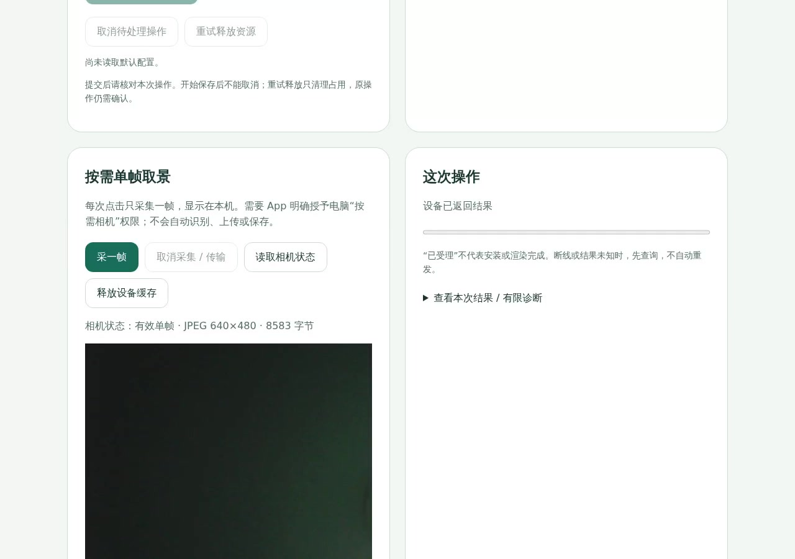

# 2026-11-03 傻妞功能复测、录像与缺陷修正

本记录对应 11 月 3 日下午连接的 AIDK 实板、Android API 36 模拟器及随后完成的
日志修复构建。它是本次运行的证据快照；板级当前验收仍统一由
`boards/bk7258/CONFIGS.md` 维护。实测阶段未提交、上传、刷机或替换设备 owner；
后续依赖发布与提交前检查见下文。

[本地录像播放器](index.html) · [22 项功能明细](summary.json) ·
[视频时长与 SHA-256](video-manifest.json) · [校验文件](SHA256SUMS)

19 段均已核对哈希、按源时间基逐帧解码并在本地浏览器播放，见
[文件与播放校验](playback-validation.json)；文件可播放不增加功能验收范围。

## 设备与适用范围

- 模拟器 App：`0.7.27-shaniu-wake-import` / code 57。已安装 App、测试 APK 与
  本地增量构建产物的 SHA-256 一致，完整值见 `summary.json`。
- 实板：已核对同一台 AIDK，公开身份摘要前缀 `571ab95e`；CP 返回
  `NuttX 0.0.0 892be7ba7dc arm aidk_ai_toy`。固件版本接口返回 `-138`，未建立完整
  CP/AP 镜像对应关系，因此不把本次结果归为 770 或本日新编译的固件。
- 板端在连网前仍使用旧日期，联网后完成校时。日志保留原时间，关联依据是本轮
  操作、回执和会话顺序，归档日期采用主机的 2026-11-03。
- 模拟器使用合成设备状态和响应，不具备真实手机 BLE、NFC、振动或声音的验收效力。
  自动录像没有环境音；受保护的认领/配网页会黑屏，未关闭安全窗口保护。

## 实板结果与对应素材

| 功能 | 本次观察 | 录像或回执 | 保留边界 |
| --- | --- | --- | --- |
| 电脑按需取景 | 两帧 640×480 JPEG；保存当前帧、取消后重拍及释放缓存均返回成功 | [55 秒原速录像](videos/board/camera-capture-cancel-recapture.mp4)、[逐步回执](evidence/camera-events.json) | 画面偏暗；仅工作台录屏，尚缺物体、设备和操作者同框素材 |
| 电脑任务 | 正常子进程返回 0；超时任务 `reason=timeout`、子进程返回 1、CLI 返回 130；两者 `device_result=confirmed` | [成功](evidence/pc-task-success.json)、[超时](evidence/pc-task-timeout.json)、[CLI 退出值](evidence/pc-command-exits.json) | 只有日志，没有同框录像；`feedback_verified=false` |
| 手机单次审批 | 无人批准时返回 `expired`，`process_returncode=null`，命令未执行 | [过期回执](evidence/approval-expired.json) | 只通过负向分支；手机批准和拒绝未实测 |
| 动作、表情与触觉 | 加速度样本持续更新；happy→neutral 渲染与回读一致；任务反馈的两次振动驱动返回 0，之后采集恢复 | [任务及振动日志](evidence/board-pc-tasks.redacted.log)、[表情与外设日志](evidence/board-peripheral-actions.redacted.log) | 未人为拿起/倾斜；双眼外观与实际振感待确认。串口脉冲的 `-16` 是 MIC 互锁拒绝 |
| Wi-Fi 与语音配置 | 临时连接成功，最终仍在线；SCB4 保存记录仅含 owner，SSID、服务地址、证书和云服务字段均为空 | [连接结果](evidence/wifi-connected.json)、[非敏感配置头结果](evidence/voice-configuration-presence.json) | `ready=false` 对应缺少配置；未验证本轮语音或重启自动重连 |
| NFC | 扫描返回 `-110`，没有确认有兼容卡放在感应区 | [外设日志](evidence/board-peripheral-actions.redacted.log) | 无实卡成功记录，不能据此判定模块损坏 |
| 资源与系统状态 | 现有电脑授权读取资源目录/默认/试用状态被拒绝 `-13`；AP 健康计数 faults/recoveries 为 0，双屏恢复 neutral | [最终状态](evidence/board-final-readback.redacted.log)、[功能明细](summary.json) | 资源正向操作需已有 owner 授予相应权限；短时间健康不代替长稳 |

两帧分别为 8,583 B 与 11,767 B；帧传输时间为 1.413 s / 2.020 s，工作台后端
取景与读取流程为 4.429 s / 5.067 s。这些不是点击到浏览器显示的端到端延迟统计。
保存后的 JPEG 哈希与第一帧回执一致。取消后复拍的请求 ID 为 3，最后缓存有效标志
为 false、大小为 0；释放后的 canceled 状态不当作此前取景失败。

### 当晚真人唤醒故障复现

用户现场说“你好 openvela”，报告试了 3 次、没有应答，随后补充眼睛在动。
180 秒串口采集中有两次本地匹配进入对话启动，候选分数分别为 976/1000、859/1000，
随后均返回 `BKVOICE local wake turn start failed=-100`（`ENETDOWN`）。
不能将三个口述尝试逐一与日志对应，因此不据此计算识别率。

本次重新读回：Wi-Fi 为 disconnected，语音 `ready=false`；持久配置的 SSID、
密码、服务地址、证书和云服务长度均为 0。只读了 32 B 非敏感配置头。
当前代码在服务未就绪时不启动 ASR 或播放唤醒应答，与此次“听到唤醒却没有回应”一致。
尚未恢复在线对话；需要已绑定手机补齐网络和语音服务，再验证保存、对话与重启恢复。
未修改模型、阈值、绑定或固件，也未录制环境音或实物视频。
见[本次状态与边界](evidence/home-wake-20261103.json)、[对应串口片段](evidence/home-wake-20261103.redacted.log)。

### 夜间配置、真人语音与 App BLE 跟进

下午/早晚的配置缺失、`ENETDOWN` 与录像仍是原始快照，未改写成“全绿”。其后，同一
AIDK（公开身份摘要前缀 `571ab95e`）经已绑定手机补齐配置后，真人说出唤醒词和问题，
现场确认听到延迟回答。该单次会话使用 `mimo-v2.6-flash`：从 capture close 到首个 PCM
为 32,799 ms，其中 ASR final 为 1,813 ms、规划为 3,948 ms、最终请求到首 token 为
25,394 ms。它是一次观察，不是通用延迟指标；没有录制环境音或实物视频。

同一真机/同一板的 App 更新为 version code 58、`0.7.28-shaniu-mimo-chat`，APK SHA-256
为 `c2cf93b2d7bba13c29cb3de5bf95a9da799a5ee3a10cf137bd863058d9d3700b`。默认聊天模型改为
`mimo-v2.6-flash`，ASR/TTS 仍为 `mimo-v2.5-asr`/`mimo-v2.5-tts`。协商 MTU 为 71 时，
20 B 基线单次 TLS ready 为 3,264 ms；兼容上限 67 B 的单次为 2,853 ms。该数值包含连接、
发现、MTU、订阅和 TLS，不是批量吞吐结论；此前 68 B 首包超时保留，64 B 与 67 B 实机连接
成功。185 MTU 时维持 182 B 上限。

板端还修正 advertise MTU 接收头空间少 1 B 的缺陷；新 NuttX 真实主机测试 2 项、Android
构建/单元/lint 与固件增量构建通过。未刷板，运行固件仍未能完整识别。上述晚间证据见
[语音、App 与 BLE 跟进回执](evidence/voice-app-ble-followup.json)及
[脱敏阶段日志](evidence/voice-app-ble-followup.redacted.log)。
[真手机发现、认证与状态回读录像](videos/phone/app58-ble-connect.mp4)记录同一 APK 的另一次
成功连接，不含环境音或实物画面，也不作为语音音质、OTA 或大文件吞吐验收。

### 11-04 电脑审批感叹号缺失

用户报告等待手机批准和点同意后都没有感叹号，只有振动。源码确认：
`bkpc_approval_visual()` 在等待批准时产生 state 7，但 `bk7258_display_focus()`
只接受 state 1–6，直接丢弃审批显示；振动由独立路径触发。预期行为是在等待批准时
显示感叹号，审批结束后退出提醒，批准后不继续显示该感叹号。

修复提交 `c34135cbd4b501bdef98aff9b29d2439838af2b9` 放行已有的 state 7，仍拒绝
state 8 和超过 32 的进度。回归使用实际审批状态生成、显示入口及绘制实现，检查
两块 framebuffer 的感叹号竖线、圆点和间隙，以及批准后的清除。修复前在显示入口
断言失败，修复后通过；AIDK MCUboot CP/AP 增量构建和修改行风格检查通过。

这是源码和主机像素数据证据，没有实物显示录像。`0.7.128+774` 仍包含该缺陷；
775 候选固件尚未刷入，不能标为双眼显示已验收。后续实机观察需与该次实际刷入
镜像对应，不能复用之前电脑任务的返回成功或振动记录作为显示通过证据。

## 手机模拟器录像

14 组检查均取得通过记录。下表录像按原速保留，测试数字、状态和响应均为夹具数据。
深浅色、表情、专注等 UI 可以观察；安全窗口的黑屏须结合对应日志阅读。

| 检查 | 录像 | 结果日志 |
| --- | --- | --- |
| 浅色 UI 与导航 | [133.07 s](videos/emulator/gallery-light-01.mp4) | [PASS](evidence/emulator/gallery-light.log) |
| 深色 UI 与导航 | [84.51 s](videos/emulator/gallery-dark-01.mp4) | [PASS](evidence/emulator/gallery-dark.log) |
| Keystore/TLS 与安全状态 | [74.94 s，含受保护画面](videos/emulator/security-memory-01.mp4) | [PASS](evidence/emulator/security-memory.log) |
| 设置状态与门禁 | [7.28 s](videos/emulator/settings-state-01.mp4) | [PASS](evidence/emulator/settings-state.log) |
| 表情导入草稿 | [13.98 s](videos/emulator/eyes-draft-01.mp4) | [PASS](evidence/emulator/eyes-draft.log) |
| 表情安装后台取消 | [4.99 s](videos/emulator/eyes-background-cancel-01.mp4) | [PASS](evidence/emulator/eyes-background-cancel.log) |
| 默认表情选择 | [43.53 s](videos/emulator/default-expression-01.mp4) | [PASS](evidence/emulator/default-expression.log) |
| 表情试用导航 | [73.54 s](videos/emulator/expression-trial-01.mp4) | [PASS](evidence/emulator/expression-trial.log) |
| 专注计时草稿 | [45.72 s](videos/emulator/focus-timer-01.mp4) | [PASS](evidence/emulator/focus-timer.log) |
| 电脑配对与导入取消 | [14.84 s](videos/emulator/pc-authorization-01.mp4) | [PASS](evidence/emulator/pc-authorization.log) |
| NFC 场景卡草稿 | [76.39 s](videos/emulator/nfc-scenes-01.mp4) | [PASS](evidence/emulator/nfc-scenes.log) |
| 配网输入校验 | [88.00 s，受保护画面](videos/emulator/provision-validation-01.mp4) | [PASS](evidence/emulator/provision-validation.log) |
| 11 个配网异常场景 | [11.92 s，恢复图形环境后完整复测](videos/emulator/provision-errors-recovered-01.mp4) | [PASS](evidence/emulator/provision-errors-recovered.log) |
| BLE 扫描 API | [4.42 s](videos/emulator/bluetooth-api-01.mp4) | [PASS；0 个真实外设](evidence/emulator/bluetooth-api.log) |

首次配网异常组合外层超时 600 s；后续拆分中捕获到测试线程等待 Activity 启动、
渲染线程卡在模拟器 EGL 的情况。保留数据并以软件渲染重启同一 AVD 后，剩余单项
及完整组合通过。11 个单项结果见 `summary.json`。初次失败的 4 段原片保留在
[诊断录像 1](videos/diagnostics/provision-timeout-01.mp4)、
[2](videos/diagnostics/provision-timeout-02.mp4)、
[3](videos/diagnostics/provision-timeout-03.mp4)、
[4](videos/diagnostics/provision-timeout-04.mp4)，不作为成功演示。

此前主机检查累计有 345 个不同 Android 用例通过；这是多个运行的通过并集，
其中包括补跑的 9 项，不是一次运行的“345/345”。此前的软件构建记录保留在
[同日综合软件验证](../2026-11-03-comprehensive-software-validation.md)，与这次板测分开。

## 问题分类与修复

| 项目 | 处理 | 验证层次 |
| --- | --- | --- |
| 录音正常结束误报错误 | 空停止帧不再检查媒体时间戳；正常 EOF 不再打印编码失败，真正错误仍保留 | [补丁](evidence/media-recorder.patch)；AIDK 增量构建通过，实际媒体对象重编译；未刷板 |
| 临时 Wi-Fi 验证脚本误判 | CONNECTED 枚举从错误的 1 改为 3 | [真实连接记录及两种拒绝情况检查](evidence/wifi-parser-check.json)通过 |
| 振动 -16 | 更正报告分类：直接串口入口被麦克风互锁拒绝；正常产品路径两次驱动返回 0 | 实板日志；体感未验收 |
| 下午语音未就绪 | 仅读取 32 B 非敏感配置头确认缺少网络/服务参数，没有读取控制密钥或凭据 | 下午快照保留；夜间已由已绑定手机补齐配置并完成一次真人语音观察，见上节；重启恢复和长期稳定性仍未验收 |
| App 模型与 BLE 写入 | 聊天默认改为 `mimo-v2.6-flash`；MTU 71 的兼容写入上限改为 67 B，185 时仍为 182 B | 同板真机单次 67 B TLS ready；68 B 首包超时仍保留，非吞吐基准 |

详细修复和构建身份见[修复结果](evidence/bugfix-result.json)。媒体修复随后发布为
[`eee16420`](https://github.com/Embracecactus/frameworks_multimedia_media/commit/eee164209463601512683acef433fee687d3844a)，
团队 manifest 已固定该依赖；上述下午记录仍为原测试快照。构建和源码发布
不表示修复已经运行在板上。模拟器权限、软键盘和主题已恢复，临时工作台服务已关闭。

## 提交前软件复核

修复了随接口演进失效的测试源码提取与夹具，并保留原验收 ID 对应的真实测试。
主机合同执行 996 项全部 PASS、生产输入未在运行中改变；收集阶段发现 12 个已有用例
漏登记，补齐后用原执行结果通过真实收集器复核，30 项收集器自检也通过。
原失败记录仍保留在本地，没有把失败运行改写为一次命令全绿。
BK7258 主机回归、Android debug/App 测试 APK 构建、单元测试及 lint 通过。
AI 日志官方校验覆盖 209 个文件、111,849 条事件；本次新增 Claude 10 个会话和
Codex 37 个会话。上述结果与原始结果哈希见[修复结果](evidence/bugfix-result.json)。

## 后续实物配合与文件说明

已由绑定手机补齐服务配置，并完成一次真人语音观察；下一步是重启后的保存/恢复、手机
批准/拒绝、NFC 刷卡、动作与振感、资源回读和 App OTA。原生安装仍需先解决发布身份配置；
功耗、多人唤醒与长稳属于单独验证，短片不替代统计。

已合并 PR #140 的公开基线为
`8e526e238256aaa15f2c2974bd71f0d3b1d48c93`，其完整 CI
`41643031351` 成功；夜间修复需以各自提交的完整 CI 为准，前一基线的成功不代替新修复验收。

下午归档的 19 段录像约 36.64 MB：1 段实板工作台、14 段通过的模拟器录像、
4 段失败诊断原片。MP4 与本轮保留版本逐字节一致；相机 MP4 是先前 WebM 的播放兼容
副本，未变速。晚间另加 1 段真手机 BLE 连接录屏，其哈希与解码结果见晚间回执。
录像数量不等于实板功能通过数。串口副本隐藏局域网地址、缩写设备身份，
原始日志仍在本地运行目录；凭据、电脑 profile、激活资料和配置密钥未收入本目录。
本次随比赛仓提交归档；未上传独立 Release 或比赛材料网站。
